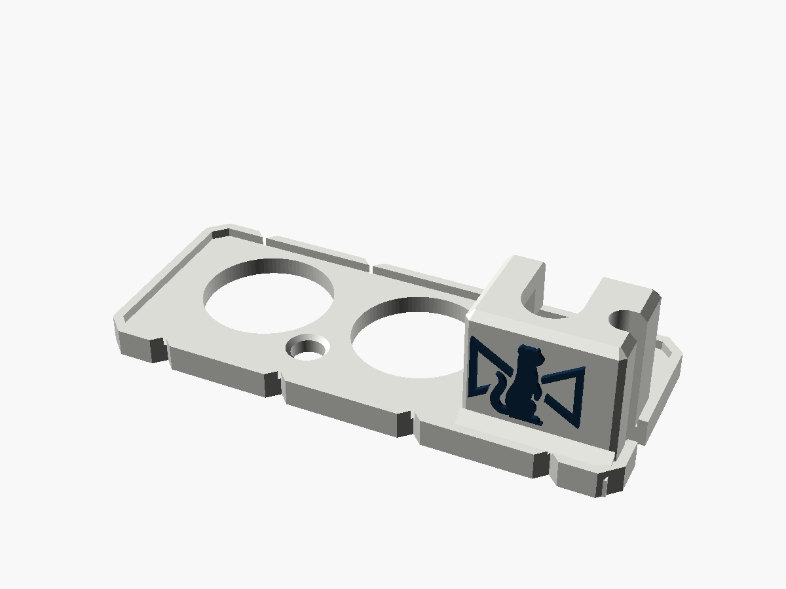
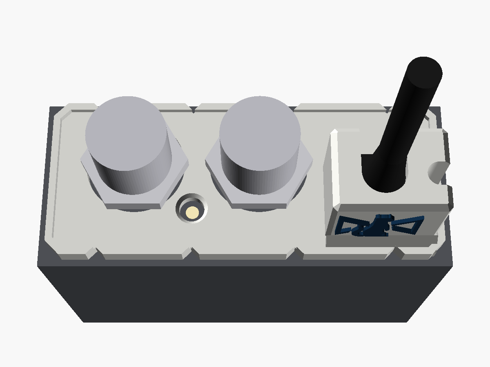
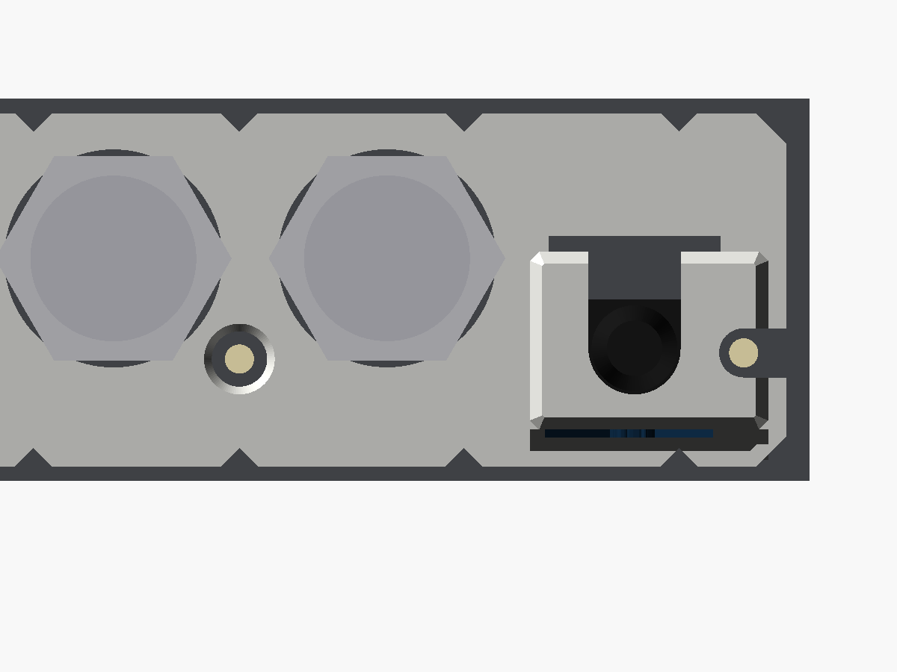
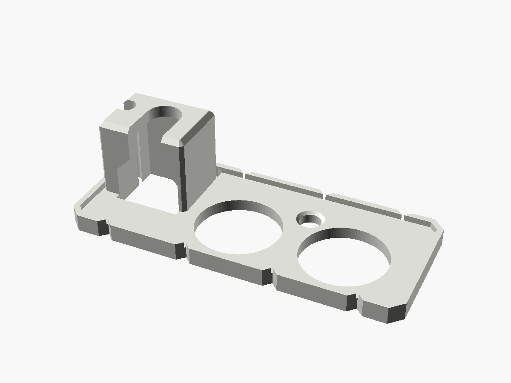
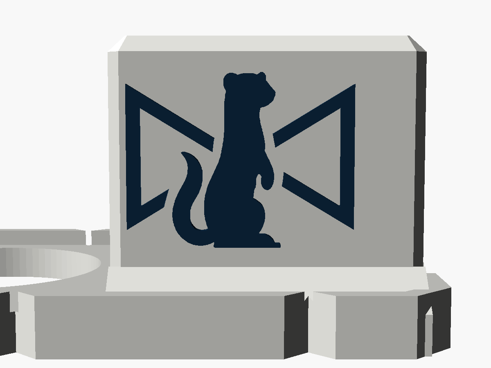

# BiDi micro-USB guard

A cover for the SDI end of the **first Blackmagic Micro Converter BiDirectional
SDI/HDMI**, the **micro-USB** model from before the 3G moved to USB-C. A tower round the
micro-USB plug stops a tug on the cable levering the port. The two BNC nuts clamp it
on, and windows show the SDI lock and power LEDs. The Stoatworks mark is on the side of
the tower.

It is the [BiDi USB guard](../bidi-usb-guard) with the pocket, cap, hooks and LED
windows moved and resized for a micro-USB plug. The plate and its BNC holes are the
same, because the BNCs are where they are on the USB-C model.

| | |
|---|---|
| Fits | Micro Converter BiDirectional SDI/HDMI, the micro-USB model, with or without the PSU |
| Fixing | the two SDI BNC nuts |
| Takes | a micro-USB plug body up to 10.6 × 6.8 mm and 13.2 mm long (see [Before printing](#before-printing)) |
| Size | 56 × 23 mm plate, 15.2 mm overall |
| Mass, solid PA6-GF | about 3.1 g |







Status: **v0.1, modelled and checked in software. Not printed or fitted.** The
micro-USB and LED positions come from a hand-held listing photo, so they're good to
about ±0.6 mm. Measure them before printing: see [Before printing](#before-printing).

---

## Fitting

1. Plug the micro-USB cable into the converter.
2. Take the nuts off both SDI BNCs.
3. From the open side, slip the cable into the slot in the tower's cap. Then slide the
   guard down over the BNCs, with the plug going up into the tower.
4. Put the nuts back on. They seat on the plate. Finger tight plus a nip is plenty.

Once fitted, the plug can't back out, because the cap sits on its moulded body. It
can't be levered sideways either: the walls hold it on three sides, and two hooks
across the top of the open side hold the fourth.

## The plug

As on the [Micro Converter micro-USB guard](../micro-converter-microusb): the
pocket is sized for the flat micro-USB moulding with a "B" on it and a ribbed boot that
Blackmagic's and Decimator's stock supplies use, about 10.6 × 6.8 mm and 13 mm long from
photos. The cap sits 13.2 mm off the panel. A wider moulding won't go in (change
`plug`); a longer or much shorter one needs `pocket_h` changing.

## The LEDs

On this model the LEDs sit higher than on the 3G: both about 4 mm below the panel's
centre.

- **Lock LED**, between the BNCs: a 3.6 mm window through the plate, countersunk on the
  outside so it can be seen at an angle.
- **Power LED**, just right of the micro-USB socket and close beside the plug's
  moulding: a slot runs from round it out through the tower's +X wall and the plate,
  the full height of the tower. The wall still stands above and below the slot, so the
  plug can't be levered that way.

## Where the numbers came from

- **The BNCs and the plate** are the USB-C guard's. On the straight-on listing photo the
  BNCs line up with the 3G's to within about half a millimetre. The case's end is the
  same size (58.9 × 24.9 mm) on both.
- **The micro-USB and the LEDs**, from that photo (an eBay listing, 1600 px), scaled
  within the panel's own plane by the micro-USB bezel. Its size is taken from
  Blackmagic's to-scale render of the one-way models' bezel (8.06 × 3.31 mm), which
  agrees with the panel's height in the photo.

| | Here | The USB-C model |
|---|---|---|
| Socket centre, from the panel's centre | 18.1 mm right, 3.8 mm down | 18.55 right, about 3.2 down |
| Power LED | 25.2 right, 4.1 down | 24.8 right, 7.4 down |
| Lock LED | 7.6 left, 4.5 down | 6.8 left, 7.4 down |

## Before printing

Take these with calipers:

1. **Your micro-USB plug:** the moulding's width and thickness (for `plug`), and its
   length from the socket to where the boot starts (for `pocket_h`).
2. **The socket and LEDs:** each centre, from the panel's centre (or from the right-hand
   edge and the bottom). Change `usb`, `led_pwr` and `led_lock` if they're more than
   about 0.4 mm out.

Then print one, fit it, and check both LEDs show on a powered converter.

## Printing

As the USB-C BiDi guard: plate on the bed, as modelled; no supports (the hook
undersides are 45°); 0.12 mm layers for the mark; **PETG or PA6-GF, not PLA**, since
the BNC nuts clamp the plate; `-body.stl` plus `-logo.stl` for two colours.

## What has been checked

In software only, by `check.py` (it reads its numbers from the `.scad`):

- One closed solid, inside the converter's end, with no near-duplicate vertices.
- Nothing within 0.3 mm of either LED, all the way up.
- Both BNC nuts turn freely, with 0.3 mm to spare at their corners, and seat on the
  plate at their corners (the holes are wider than the nut across its flats, as on the
  USB-C guard).
- A 10.6 × 6.8 mm plug body, 13.2 mm long, goes in, a 4.5 mm cable passes the cap, and
  the cap is over both ends of the body. It's solid under the body, walled on both
  sides (on the +X side above and below the LED slot), and hooked across the top.
- The STLs re-import into OpenSCAD cleanly.

**Not done:** slicing, printing and fitting, and the measurements above.

## What changed from the USB-C guard

- The pocket, cap slot (6 mm) and hooks, for a smaller plug, 0.5 mm further in.
- The tower is 5 mm shorter, for a shorter plug.
- The power LED's light slot runs out through the tower's side instead of an L-shaped
  bite out of its corner, because the LED is beside the plug, not below it.
- The lock-LED window's countersink starts inside the window and overshoots the face,
  which removes the 133 near-duplicate vertices the USB-C guard has there.

## Files and rebuilding

| File | |
|---|---|
| `bidi_microusb_guard_v0.1.stl` | print this |
| `bidi_microusb_guard_v0.1-body.stl`, `-logo.stl` | the two-colour pair |
| `bidi_microusb_guard.scad` | the model; every number above is a named parameter at the top |
| `stoatworks_mark.scad` | the mark as one polygon, generated, do not edit |
| `check.py`, `preview.scad`, `previews.sh` | checks and pictures |

```bash
openscad -o bidi_microusb_guard_v0.1.stl bidi_microusb_guard.scad
```

```bash
python3 -I check.py
```

The two-colour STLs come from the same command with `-D 'part="body"'` or
`-D 'part="logo"'`. `check.py` needs numpy, trimesh, manifold3d, scipy, rtree and
matplotlib.

Designed with Claude.
