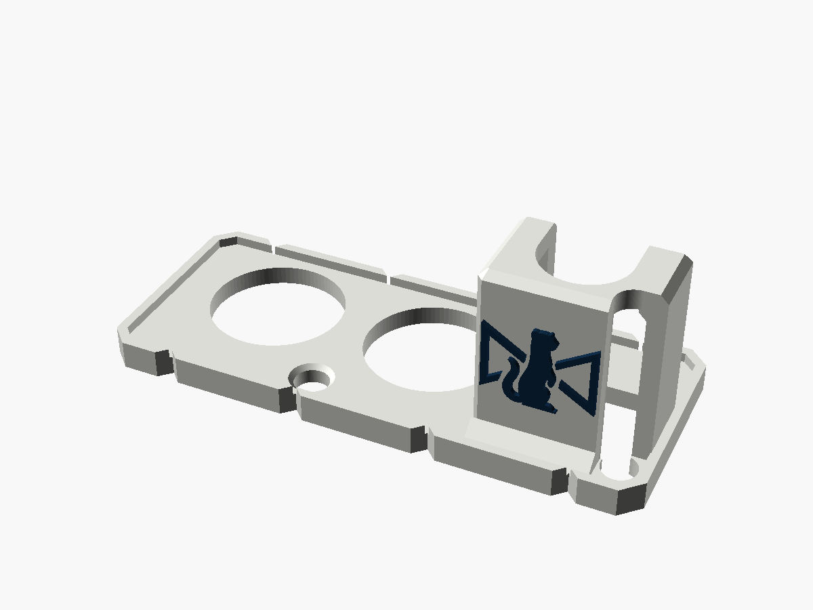
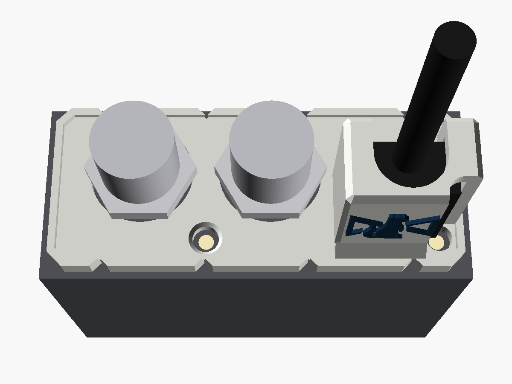
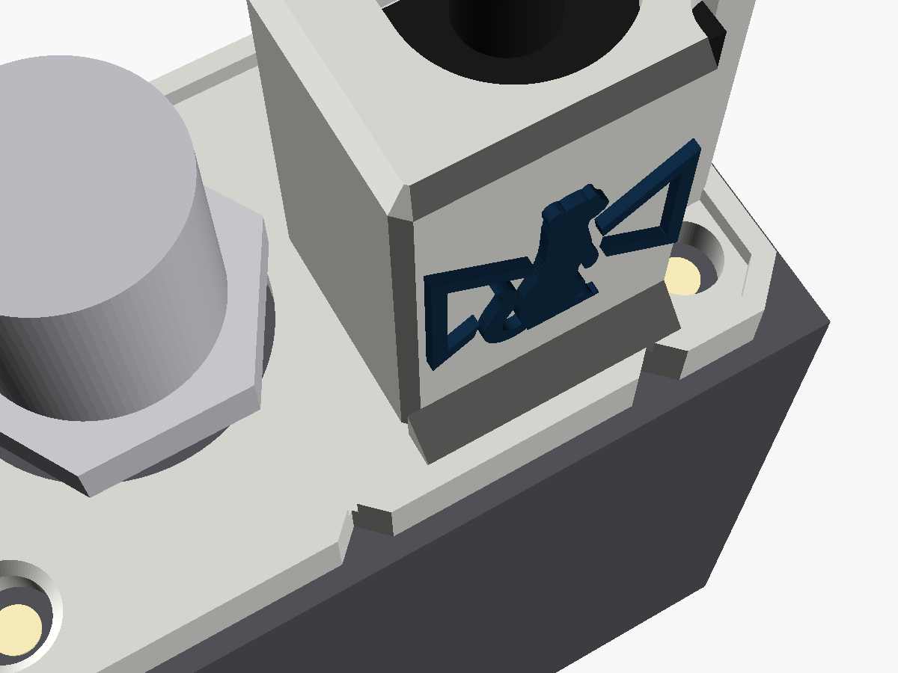

# BiDi USB guard

A cover for the SDI end of a **Blackmagic Micro Converter BiDirectional SDI/HDMI 3G**
(the USB-C model). A tower round the USB-C plug stops a tug on the cable from levering
the port. The two BNC nuts clamp it on, and windows show the SDI lock and power LEDs.
The Stoatworks mark is on the side of the tower. For the earlier micro-USB model, see
[`../bidi-microusb-guard`](../bidi-microusb-guard).

| | |
|---|---|
| Fits | Micro Converter BiDirectional SDI/HDMI 3G, USB-C model, with Blackmagic's own USB-C supply plugged in |
| Fixing | the two SDI BNC nuts |
| Size | 56 × 23 mm plate, 20.2 mm overall |
| Mass, solid PA6-GF | about 3.1 g |





Status: **v0.1, test-fitted on a real converter** (Allan, reported 2026-10-23), after
being modelled and checked in software. Published at
<https://stoatworks-labs.com/parts/bidi-usb-guard/>. See
[What has been checked](#what-has-been-checked).

---

## Fitting

1. Plug the USB-C cable into the converter.
2. Take the nuts off both SDI BNCs.
3. From the open side, slip the cable into the slot in the tower's cap. Then slide the
   guard down over the BNCs, with the plug going up into the tower.
4. Put the nuts back on. They seat on the plate. Finger tight plus a nip is plenty.

Once fitted, the plug cannot back out, because the cap sits on its moulded body. It
cannot be levered sideways either: the walls hold it on three sides, and two hooks
across the top of the open side hold the fourth.

## The LEDs

The converter has two LEDs on this end, both near the bottom edge of the panel: the
SDI lock LED between the BNCs, and the white power LED to the right of the USB-C port.
The original part covers both.

- **Lock LED:** a 3.6 mm window through the plate, countersunk on the outside so it
  can be seen at an angle.
- **Power LED:** this one sits right beside the plug's moulded body, under where the
  tower's corner would be. A hole in the plate would show nothing. Instead a light
  well is cut down the whole height of the tower's corner, with the window at its
  foot.

## Where the numbers came from

- **The converter's interface**, taken from dj12bas's "Blackmagic BiDi USB Protector
  V3 (16.7 mm)": BNC holes 14.2 mm on 17.8 mm centres, the plug pocket, the pocket's
  roof height and the hooks. These describe the converter and Blackmagic's plug, and
  dj12bas's part shows they fit. `check.py` compares the two parts: this pocket is
  nowhere tighter than theirs.
  - Despite the name, their pocket roof is **18.2 mm** off the panel. 16.7 mm is only
    where its straight walls stop before a fillet. This design uses 18.2.
- **The LEDs**, from Blackmagic's end-view render of the converter, scaled by its
  catalogue size (58.93 × 24.89 mm). As a cross-check, the render's BNC spacing comes
  out within 0.15 mm of dj12bas's holes. Each LED is about 2.1 mm across. The windows
  are 3.6 mm, so there is 0.75 mm of leeway all round.
- **The BNC nut**, from the same render: 13.7 mm across flats, 15.4 mm across
  corners. The lip and the tower are kept at least 0.7 mm clear of the corners as the
  nut turns. The plate stays 2.0 mm thick where the nuts seat, like the original,
  because the BNC thread has no room for a thicker plate.

## What makes it its own design

It was written from scratch in OpenSCAD, and shares only the interface above with the
original. Everything else is new:

- the windows for both LEDs, and the light well down the tower;
- a raised 1 × 1 mm lip round the outer face. It stiffens the plate, especially the
  2.35 mm strips above the BNC holes, the weakest part of a plate like this;
- four 90° V-notches in each long edge, 1.2 mm deep. They sit at −21, −7, 7 and 21 mm,
  clear of the BNC strips, the nuts and the LED windows. The −7 one lines up with the
  lock LED;
- chamfered corners and edges in place of rounds;
- a 1.6 mm wall on the -Y side (the original's is 1.2) with a 45° fillet running into
  the lip;
- a 2 mm cap (the original's is 1.2);
- the Stoatworks mark, 10.9 × 8.4 mm, raised 0.5 mm on the tower's side.

The original's pocket, hooks and roof dimensions are reused because the plug and
converter are the same. This design takes those dimensions, not the original's shape.
Allan's call (2026-10-23): it is a complete redesign, so dj12bas's personal-use licence
on the original doesn't restrict it, and it can be published, sold and used as hire
stock. The website still credits dj12bas for the measurements.

## Printing a batch

- **Print one first** and fit it with the cables the batch will be used with. The
  pocket is sized for Blackmagic's own USB-C supply. Other cables' moulded bodies vary,
  and one longer than 18.2 mm or fatter than 13.5 × 7.5 mm will not go in. For those,
  change `pocket_h` (and `pocket_x` / `hook_y`) and re-export.
- Plate on the bed, as modelled. No supports. The hook undersides are 45° and the cap
  overhangs the walls by about 2 mm.
- 0.12 mm layers for the mark. The original's designer used 3 walls and 25 % infill,
  and so can this.
- **PETG or PA6-GF, not PLA.** The BNC nuts clamp the plate, and PLA creeps under a
  constant load, so the nuts work loose. The converters also run warm. PA6-GF is the
  stiffest choice and blurs the mark a little. PETG keeps it sharper.
- For a plate of them, import the STL once, add copies and let Bambu Studio arrange
  them. At 56 × 23 mm, plenty fit on one plate.
- **Two colours:** `-body.stl` plus `-logo.stl` (same coordinates). Load both as one
  object with two parts and give the logo its own filament.

## What has been checked

**On a real converter:** test-fitted by Allan (reported 2026-10-23).

In software, by `check.py` (it reads its numbers from the `.scad`):

- One closed solid, inside the 56 × 23 mm end.
- Nothing within 0.3 mm of either LED, all the way up.
- Both nuts turn freely, with 0.3 mm to spare at their corners, and seat on the full
  2 mm plate.
- The BNC holes match the original's to 0.01 mm. The plug opening and pocket cover
  the original's. The pocket roof is at 18.2 mm (original 18.0–18.2) and the hook
  undersides at 11.9 mm (original 11.9).

`check_sections.png` overlays the two parts at three heights.

**Not recorded yet:**

- whether both LEDs show through their windows on a powered converter. They come from
  a render, not a measurement;
- whether USB-C plugs other than Blackmagic's own fit.

## Files and rebuilding

| File | |
|---|---|
| `bidi_usb_guard_v0.1.stl` | print this |
| `bidi_usb_guard_v0.1-body.stl`, `-logo.stl` | the two-colour pair |
| `bidi_usb_guard.scad` | the model; every number above is a named parameter at the top |
| `stoatworks_mark.scad` | the mark as one polygon, generated, do not edit |
| `check.py`, `preview.scad`, `previews.sh` | checks and pictures |

```bash
openscad -o bidi_usb_guard_v0.1.stl bidi_usb_guard.scad
```

```bash
python3 -I check.py path/to/BM_BiDi_USB_Protector_V3_16.7mm.3mf
```

The two-colour STLs come from the same command with `-D 'part="body"'` or
`-D 'part="logo"'`. `check.py` needs numpy, trimesh, manifold3d and shapely (see
`../requirements.txt`). Without the original 3MF it runs every
check except the comparison. The mark is generated from the Stoatworks logo by a script that isn't in this repo, so
leave `stoatworks_mark.scad` as it is.

Designed with Claude.
