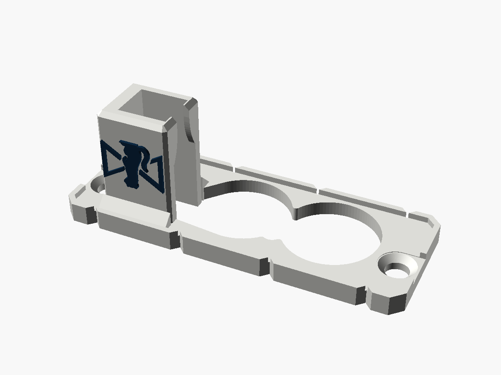
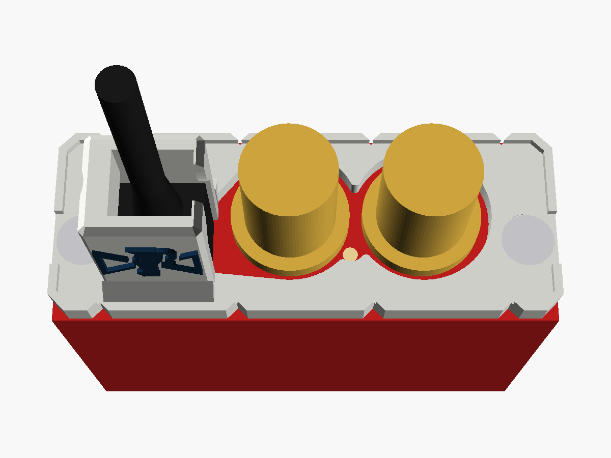
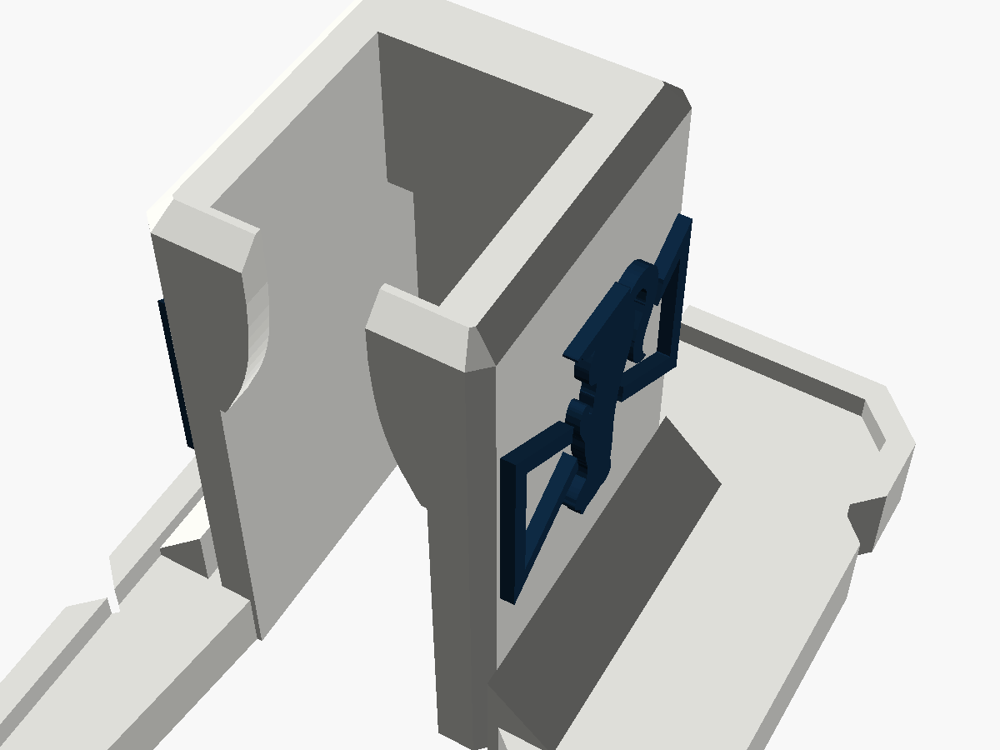
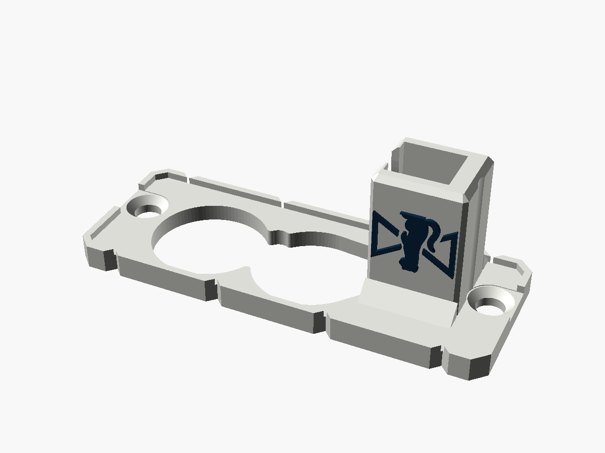

# Decimator micro-USB guard

A cover for the SDI end of a **Decimator Design MD-LX**, the **micro-USB** model from
before the USB-C one. A tower round the micro-USB plug stops a tug on the cable
levering the port, and the MD-LX's own two end screws hold it on. A window keeps the
small hole between the BNCs open. The Stoatworks mark is on both sides of the tower.

It is the [Decimator USB guard](../decimator-usb-guard) with the pocket, lips and back
wall moved and resized for a micro-USB plug. The plate, BNC holes and screw holes are
the same, because the case is.

| | |
|---|---|
| Fits | Decimator MD-LX, micro-USB model (both revisions: with or without the extra screw above the port) |
| Fixing | the MD-LX's two end-cap screws (countersunk), reused |
| Takes | a micro-USB plug body up to 10.6 × 6.8 mm and 13.2 mm long (see [Before printing](#before-printing)) |
| Size | 59.9 × 22.5 mm plate, 21.0 mm overall |
| Mass, solid PA6-GF | about 3.8 g |






Status: **v0.1, modelled and checked in software. Not printed or fitted.** The port's
position comes from a straight-on retailer photo and matches the USB-C model's. The
plug's size comes from photos: see [Before printing](#before-printing).

---

## Fitting

1. Plug the micro-USB cable into the MD-LX.
2. Take out the two screws at the ends of the SDI end panel.
3. Slide the guard down over the BNCs and the plug. The cable comes up through the
   tower's open top.
4. Put the screws back through the guard. Their heads sit flush in its countersinks.

Once fitted, the plug can't back out more than about 0.3 mm. Two lips at the tower's
open end close in over the near end of the plug body, and the back wall leans in over
its far end. It can't be levered either, because the walls hold it on three sides and
the lips on the fourth.

## Two micro-USB revisions

Retailer photos show two micro-USB MD-LXs. They're the same apart from an extra screw
directly above the micro-USB port on the later one. That screw sits in a countersunk
seat, so the plate covers it flat. If yours stands proud, the plate won't sit down: say
so and the plate gets a recess for it.

## The plug

As on the other micro-USB guards: the pocket is sized for the flat micro-USB moulding
with a "B" on it and a ribbed boot, which is what Decimator's stock cable has. From
photos it's about 10.6 × 6.8 mm across and 13 mm long. The lips start at 13.2 mm off
the panel. A wider moulding won't go in (change `plug`), and a longer or much shorter
one needs `body_h` changing. The lips leave a 4 mm gap for the cable.

## Where the numbers came from

- **The plate, BNC holes and screws** are the USB-C guard's, which has been test-fitted.
- **The micro-USB socket**, from Markertek's straight-on photo of a B-stock micro-USB
  MD-LX (1280 px, about 20.8 px/mm). It comes out 16.25 mm left of and 2.5 mm below the
  panel's centre. The USB-C guard's pocket centre is 16.3 left and 2.35 below, so the
  two ports are in the same place.
- **The small hole between the BNCs**, from the same photo, at 5.4 mm right of and
  3.3 mm below the centre. It may be an LED, so it gets a window.
- The same photo puts the BNCs and end screws within about 0.5 mm of the USB-C guard's
  numbers.

## Before printing

Take these with calipers:

1. **Your micro-USB plug:** the moulding's width and thickness (for `plug`), and its
   length from the socket to where the boot starts (for `body_h`).
2. **The socket:** its centre from the panel's centre, expected 16.25 mm left and
   2.5 mm down.
3. **The extra screw above the port**, if yours has one: whether its head is flush.

Then print one and fit it.

## Printing

As the USB-C guard: plate on the bed, as modelled; no supports; 0.12 mm layers for the
mark; **PETG or PA6-GF, not PLA**; `-body.stl` plus `-logo.stl` for two colours.

## What has been checked

In software only, by `check.py` (it reads its numbers from the `.scad`):

- One closed solid, inside the 59.9 × 22.5 mm end, with no near-duplicate vertices.
- Both BNCs are 0.9 mm clear of their flanges all the way up. A flat head seats in each
  countersink, and its head and driver clear the plate.
- The small hole between the BNCs is left open.
- A 10.6 × 6.8 mm plug body, 13.2 mm long, goes in, and a 3.8 mm cable passes between
  the lips. The plug can back out at most 0.24 mm before a lip stops it, and 0.35 mm
  before the back wall does. It's walled under and over, so it can't be levered.
- The STLs re-import into OpenSCAD cleanly.

**Not done:** slicing, printing and fitting, and the measurements above.

## What changed from the USB-C guard

- The pocket, for a smaller plug, in the same place.
- The back wall goes straight up and leans in at 45° over the plug's far end, instead
  of following the drafted face of joren's part, which was shaped for the USB-C plug.
- The lips' profile is the USB-C guard's, lowered 2.1 mm to the shorter plug.
- A window over the small hole between the BNCs.
- The countersinks start inside the screw holes and the head clearance starts 0.1 mm
  below the plate's face. That removes the 300-odd near-duplicate vertices the USB-C
  guard has round its screws.

## Files and rebuilding

| File | |
|---|---|
| `decimator_microusb_guard_v0.1.stl` | print this |
| `decimator_microusb_guard_v0.1-body.stl`, `-logo.stl` | the two-colour pair |
| `decimator_microusb_guard.scad` | the model; every number above is a named parameter at the top |
| `stoatworks_mark.scad` | the mark as one polygon, generated, do not edit |
| `check.py`, `preview.scad`, `previews.sh` | checks and pictures |

```bash
openscad -o decimator_microusb_guard_v0.1.stl decimator_microusb_guard.scad
```

```bash
python3 -I check.py
```

The two-colour STLs come from the same command with `-D 'part="body"'` or
`-D 'part="logo"'`. `check.py` needs numpy, trimesh, scipy, rtree and matplotlib.

Designed with Claude.
