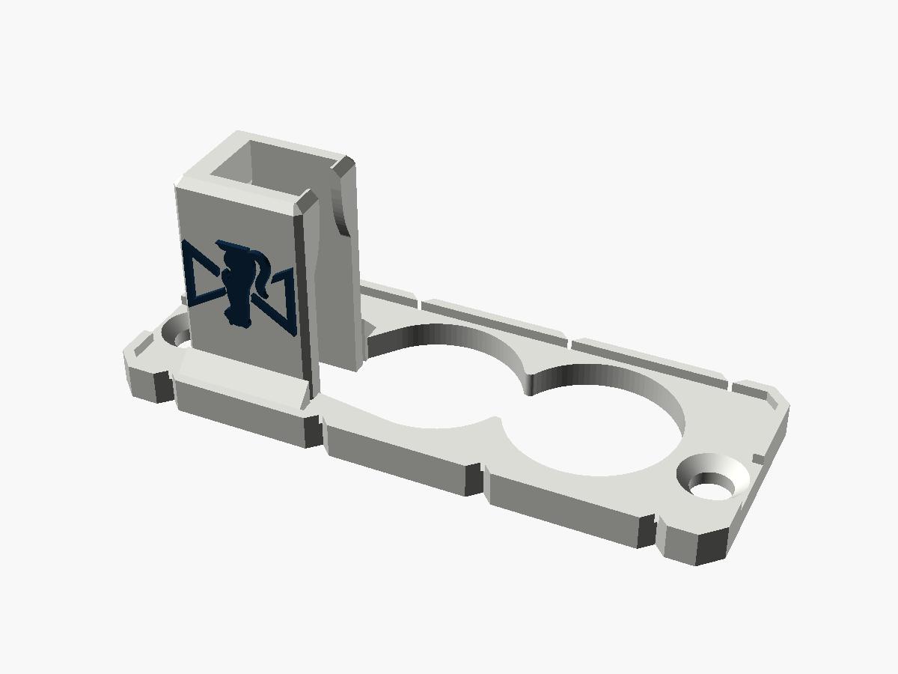
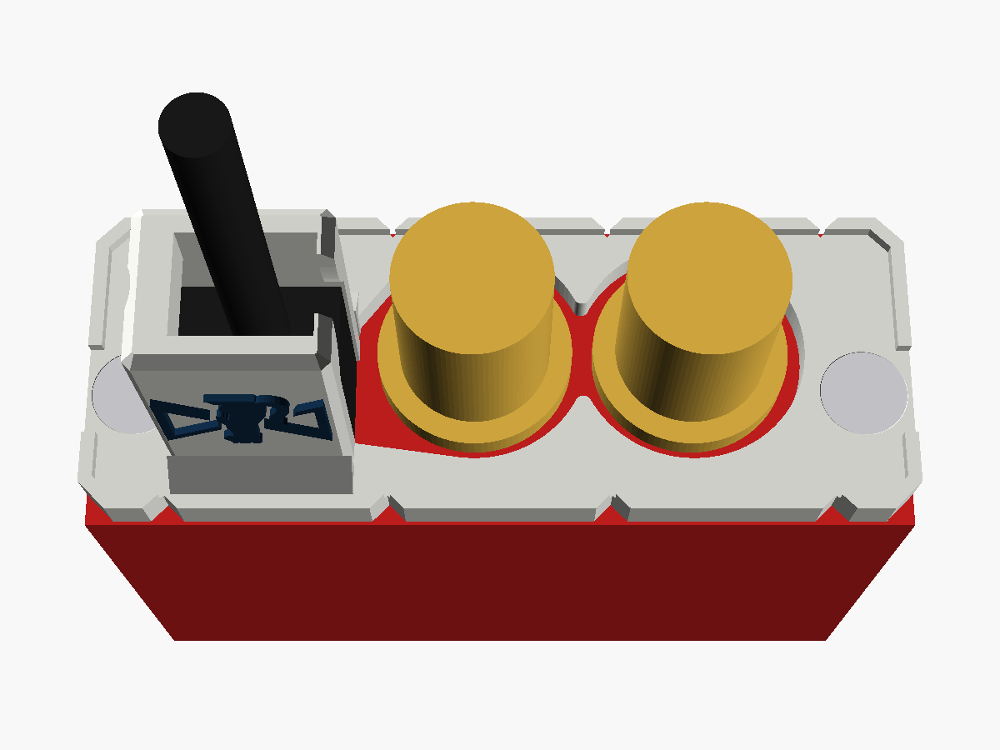
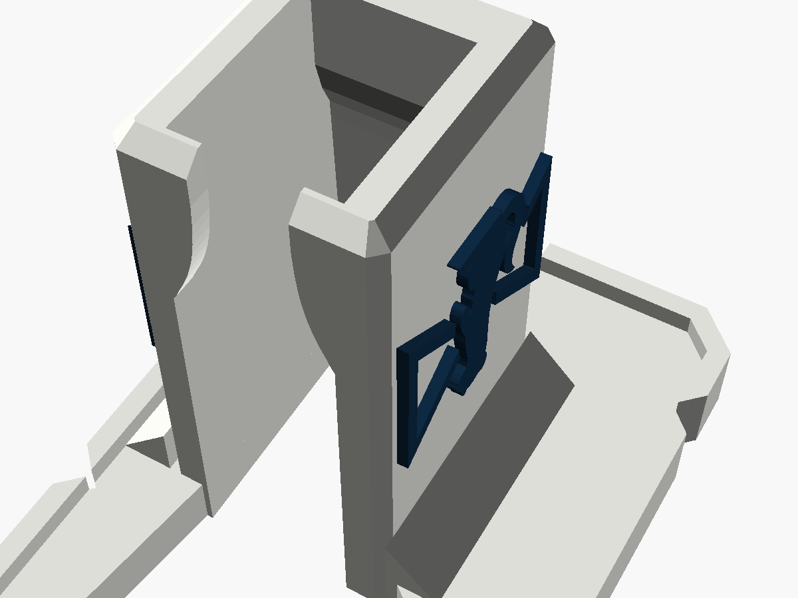

# Decimator USB guard

A cover for the SDI end of a **Decimator Design MD-LX** (the USB-C model). A tower
round the USB-C plug stops a tug on the cable levering the port, and the MD-LX's own
two end screws hold it on. The Stoatworks mark is on both sides of the tower. For the
earlier micro-USB model, see [`../decimator-microusb-guard`](../decimator-microusb-guard).

| | |
|---|---|
| Fits | Decimator MD-LX, USB-C model |
| Fixing | the MD-LX's two end-cap screws (countersunk), reused |
| Size | 59.9 × 22.5 mm plate, 23.1 mm overall |
| Mass, solid PA6-GF | about 4.0 g |





Status: **v0.1, test-fitted on a real MD-LX** (Allan, reported 2026-10-23), after
being modelled and checked in software. Published at
<https://stoatworks-labs.com/parts/decimator-usb-guard/>. See
[What has been checked](#what-has-been-checked).

---

## Fitting

1. Plug the USB-C cable into the MD-LX.
2. Take out the two screws at the ends of the SDI end panel.
3. Slide the guard down over the BNCs and the plug. The cable comes up through the
   tower's open top.
4. Put the screws back through the guard. Their heads sit flush in its countersinks.

Once fitted, the plug can't back out: two lips at the tower's open end close in over
the near end of the plug body, and the back wall leans in over its far end. It can't be
levered either, because the walls hold it on three sides and the lips on the fourth.

The MD-LX's SDI lock LED is on its top face, beside the "SDI INPUT LOCK" label, so
nothing here covers it.

## The two BNC holes

These are two round holes, not the original's oval. They overlap at a waist, because
the BNC flanges are only about 1.3 mm apart. Two separate holes would leave a web
between them under 1 mm wide, which would break or simply not fit. Each hole is
16.7 mm across, 1.2 mm clear of its 14.3 mm flange all round: the same clearance as the
original's oval gives top and bottom. The points of the waist are rounded off so they
don't chip.

## Where the numbers came from

- **The BNCs**, from Allan's photo of the SDI end, scaled by the two end screws (52.9 mm
  apart in joren's part). They come out 15.8 mm apart, at -1.85 and 13.95 mm along the
  panel, with 14.3 mm flanges.
  - Their height (1.1 mm above the panel's centre) is the centre line of joren's oval.
  - As a cross-check, the photo puts the right-hand BNC within 0.4 mm of where the
    oval's end implies.
  - A photo at an angle is good to about ±0.5 mm, which the 1.2 mm clearance covers.
- **The interface**, taken from joren's "Decimator MD-LX USB-C Protector Strain
  relief". These describe the MD-LX, its screws and the plug, and joren's part shows
  they fit:
  - the screw holes and their 90° countersinks;
  - the plug's pocket;
  - the lips' profile, traced and given 0.05 mm more room;
  - the back wall's draft, 0.1 mm further back at every height.

  `check.py` confirms there is at least as much room for the plug and cable as in
  joren's part, everywhere up to 22.5 mm.

## What makes it its own design

It was written from scratch in OpenSCAD. It shares only the interface above with the
original. Everything else is new:

- the two overlapping BNC holes in place of the oval;
- a raised 1 × 1 mm lip round the outer face, opened at each screw so the head and a
  screwdriver can get in;
- four 90° V-notches in each long edge, 1.2 mm deep, at -24, -8, 8 and 24 mm, clear of
  the thin strips above the BNC holes and the screws;
- a square tower with chamfered edges and a 45° fillet along each side's foot, in
  place of the original's drafted, rounded one;
- the Stoatworks mark, 11.1 × 8.6 mm, raised 0.5 mm on both sides of the tower. It is
  upright to someone in front of the box looking down at the tower, so upside down as
  printed.

This design takes joren's dimensions, not the shape of joren's part. Allan's call
(2026-10-23): it is a complete redesign, so the Standard Digital File License on
joren's part doesn't restrict it, and it can be published, sold and used as hire stock.
The website still credits joren for the measurements.

## Printing

- Plate on the bed, as modelled. No supports. The lips' undersides are steeper than
  45°, and the back wall leans in at 45° at most.
- 0.12 mm layers for the marks.
- PETG or PA6-GF. The screws clamp the plate, and PLA creeps under a constant load.
- **Two colours:** `-body.stl` plus `-logo.stl` (same coordinates). Load both as one
  object with two parts.

## What has been checked

**On a real MD-LX:** test-fitted by Allan (reported 2026-10-23), so the BNC holes taken
from the photo fit.

In software, by `check.py` (it reads its numbers from the `.scad`):

- One closed solid, inside the 59.9 × 22.5 mm end.
- Nothing within 0.9 mm of either BNC flange, up to 12 mm off the panel.
- Both screw heads, and a driver above them, have clear access.
- The screw holes are 4.0 mm, the same as the original's. The countersinks are 6.2 mm
  at 2.4 mm up (the original's right-hand one is 6.2; its left-hand one runs into the
  tower).
- At least as much room for the plug and cable as in the original, everywhere up to
  22.5 mm. The lips start over the plug body at 16.1 mm (original 16.0). The back wall
  is within 0.1 mm of the original's.

`check_sections.png` overlays the two parts at three heights.

**Not recorded yet:** whether USB-C leads other than the one it was fitted with go in
the pocket (11.7 × 7.0 mm, 15.3 mm tall), which is sized for the cable joren used.

## Files and rebuilding

| File | |
|---|---|
| `decimator_usb_guard_v0.1.stl` | print this |
| `decimator_usb_guard_v0.1-body.stl`, `-logo.stl` | the two-colour pair |
| `decimator_usb_guard.scad` | the model; every number above is a named parameter at the top |
| `stoatworks_mark.scad` | the mark as one polygon, generated, do not edit |
| `check.py`, `preview.scad`, `previews.sh` | checks and pictures |

```bash
openscad -o decimator_usb_guard_v0.1.stl decimator_usb_guard.scad
```

```bash
python3 -I check.py path/to/decimator-md-lx-usb-c-v1.stl
```

The two-colour STLs come from the same command with `-D 'part="body"'` or
`-D 'part="logo"'`. The mark is generated from the Stoatworks logo by a script that isn't in this repo, so
leave `stoatworks_mark.scad` as it is.

Designed with Claude.
