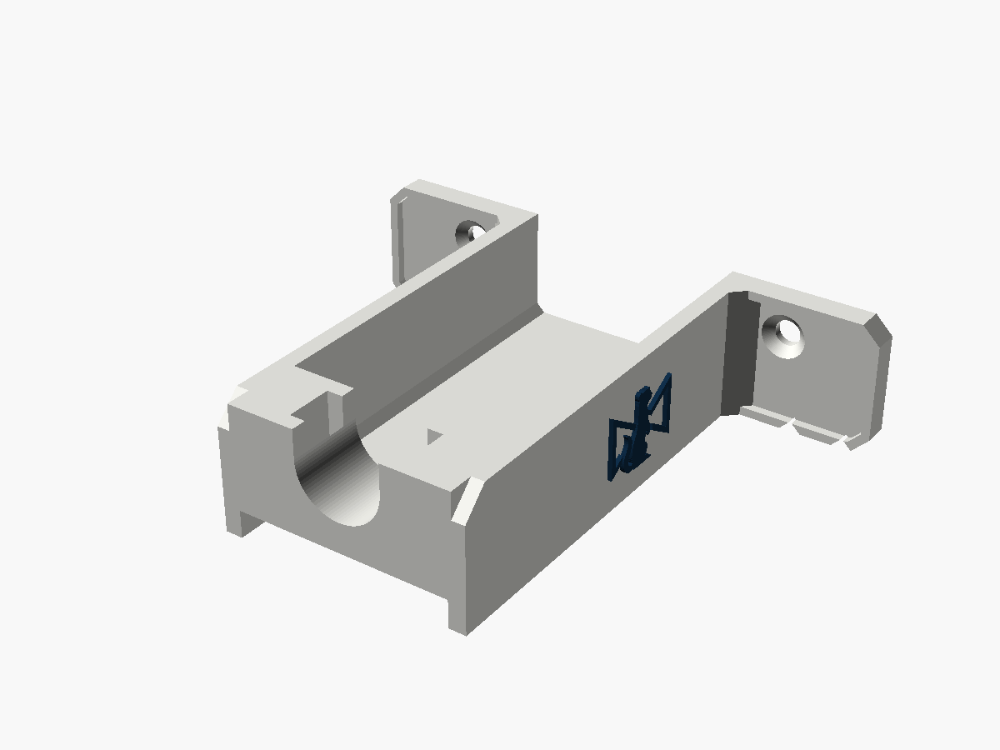
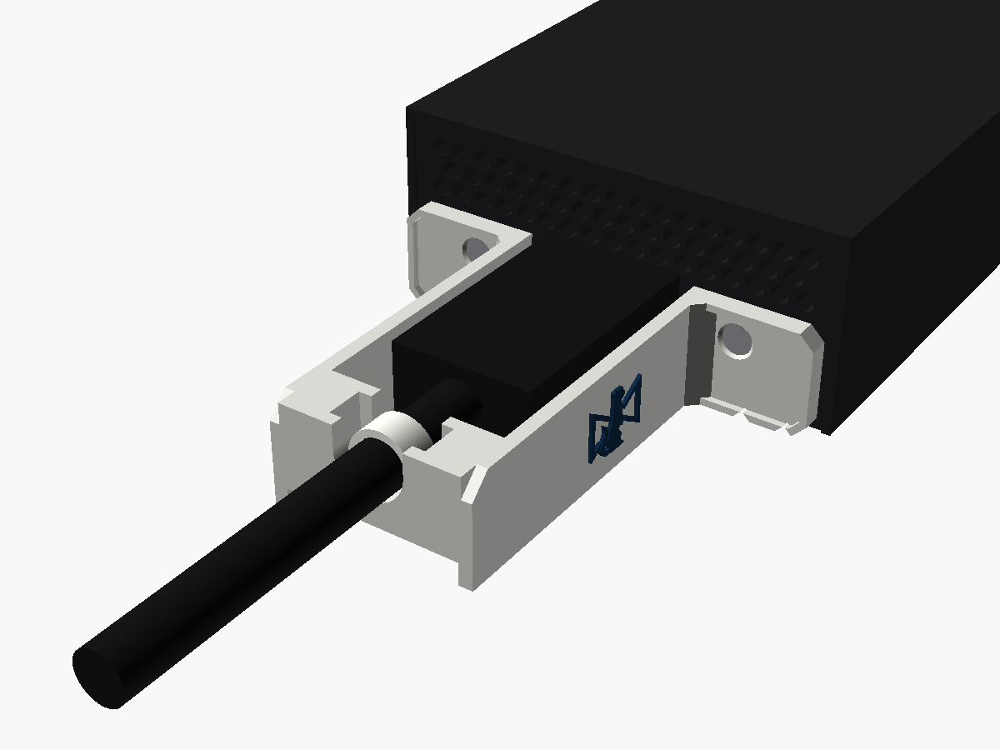
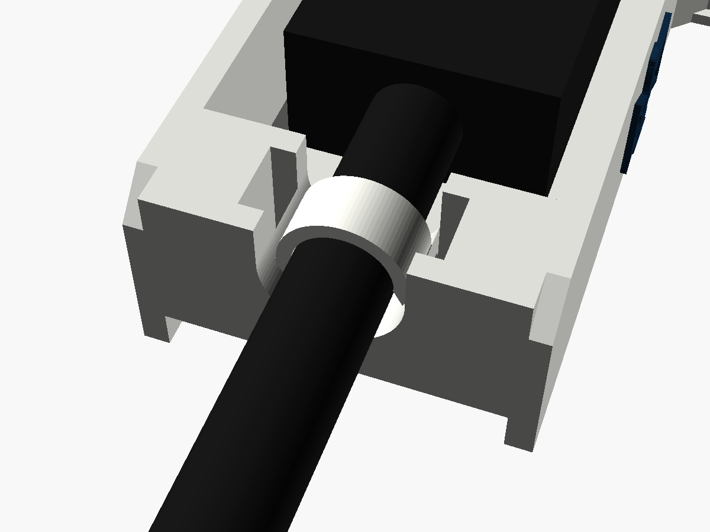
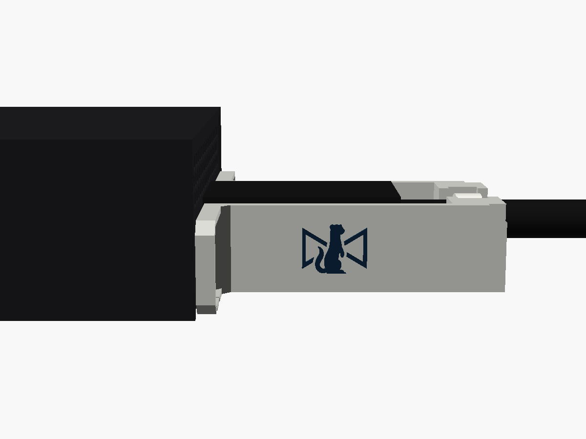
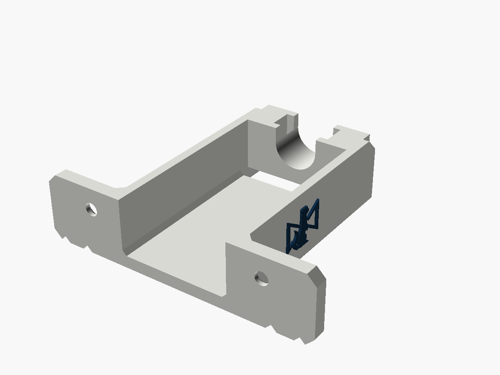

# IP Mini HDMI clamp

An HDMI cable clamp for the HDMI end of a **Blackmagic 2110 IP Mini IP to HDMI** (and
its SFP version). The HDMI output is an unlatched socket, and its lead often runs to a
screen some distance away, so the lead tends to get tugged or snagged. This clamp
takes the two screws either side of the HDMI port. A channel runs out from it under
the plug, with a wall either side of the plug's moulding, to a bar beyond the
moulding. The cable is tied to the bar, in a trough at the port's own height, so a tug
on the lead pulls on the case's screws, not on the port. The Stoatworks mark is on
both walls.

| | |
|---|---|
| Fits | 2110 IP Mini IP to HDMI and 2110 IP Mini IP to HDMI SFP: the HDMI end |
| Fixing | the two screws either side of the HDMI port, swapped for countersunk screws 2 mm longer |
| Takes | HDMI plug mouldings up to 24.2 × 14.2 mm and 41.5 mm long; cables 5–10 mm; one cable tie up to 5 × 1.5 mm |
| Size | 62 × 15 mm on the end panel, flush with the case's underside, 51 mm out from the end |
| Mass, solid PA6-GF | about 9.8 g |







Status: **v0.1, modelled and checked in software. Not printed or fitted.** The
converter's numbers come from Blackmagic's own straight-on picture of the end panel,
which is to scale (see below). The screws' size and length are the main unknowns: see
[Before printing](#before-printing).

---

## Fitting

Do this with the converter unpowered.

1. Take out the two screws either side of the HDMI port.
2. Hold the clamp on the end panel, under the vents, with the channel round the HDMI
   port. Put a countersunk screw, 2 mm longer than the one you took out, through each
   hole. Snug is enough.
3. Plug the HDMI cable in, down the channel.
4. Lay the cable in the trough at the far end. Run a cable tie over the cable, down
   one slot, under the bar's middle and up the other slot. Pull it snug, not tight:
   it only has to stop the cable sliding. Leave the cable slack between the plug and
   the bar.

From then on, a pull on the lead stops at the tie. The plug only carries its own
weight. A reusable cable tie with a release tab is kinder to hire stock than one you
have to cut off.

## The screws

The two screws either side of the HDMI port are countersunk Phillips heads, flush
with the panel. In Blackmagic's picture the countersinks are about 4.3 mm across,
which makes them **M2 or M2.5**. The holes are sized for M2.5 (2.9 mm, with a 5.0 mm
countersink), so they take either. If yours are M2, set `screw = "M2"` for a snugger
fit. If they are M3, set `screw = "M3"`.

The plate is 2 mm thick where the heads sit, so each screw needs to be **2 mm longer**
than the original. Don't reuse the originals: they would lose 2 mm of thread.

Nothing shows what these screws go into behind the panel, and it may be a blind
standoff. Before fitting the clamp, run the longer screw into the empty hole on its
own. If it stops short of its head, the hole is too shallow for it, and this clamp
needs the case's side screws instead.

## The vents

The top half of the HDMI end is a band of vents, from 1.7 mm above the panel's centre
to near the top. Every part of the clamp stays below 1.0 mm. The plug's moulding
covers some vents, as it does without the clamp. The clamp itself covers none.

## The cable and the plug

- **The trough** is a U, 10 mm across, sized so a 7 mm cable sits exactly on the
  port's axis. Other cables sit in the bottom of the U: a 5 mm one 1 mm low, a 10 mm
  one 1.5 mm high. Both are within what the cable's free length takes up. For an exact
  fit, set `cable_d`.
- **The plug's moulding** has to finish before the bar, 42 mm from the panel. Most
  HDMI plugs are 25–40 mm including the boot. For a longer one, raise `tie_z`.
- **The channel** is 24.8 mm wide, so it takes any moulding up to 24.2 × 14.2 mm
  centred on the port. A smaller moulding has room to move sideways in the channel.
  It doesn't need holding there, because the tie at the bar holds the cable.

## Where the numbers came from

Blackmagic's landing-page picture of the HDMI end is a straight-on, orthographic
render. The end measures 586 × 248 px. That is 66.04 × 27.95 mm at 8.873 px/mm, against
the catalogue's 2.6 × 1.1 in (66.04 × 27.94 mm), so the picture is to scale in both
directions to 0.01 mm.

| | Measured | |
|---|---|---|
| HDMI port | outline 15.0 × 5.3 mm, centre 0.11 mm right of and 3.83 mm below the end's centre | a type A socket |
| Screws | 19.89 mm either side of the centre, 3.68 mm below it | countersinks about 4.3 mm across |
| Vents | from 1.7 mm above the centre to the top rim, nearly the full width | |
| Rim | the case's sides stand 1.24 mm round the end panel, the top 1.35 mm, the underside none | |

- **The SFP version** was checked by differencing its picture against this one. On
  the HDMI end, 142 pixels in 145,000 differ, scattered, and no feature moves.
- **The end panel may be recessed** a little behind the case's rim, as it is on the
  Micro Converters. The plate sits on the panel itself, 0.8 mm inside the rim each side,
  so a recess doesn't matter.

## Before printing

1. **The screws:** their size, and that a screw 2 mm longer goes fully home in the
   empty hole (see above).
2. **Your HDMI lead:** the moulding's length from the panel, including any boot
   (under 41.5 mm, or raise `tie_z`), and the cable's diameter (for `cable_d`).

Then print one and fit it.

## Printing

- **On its underside, as exported.** The STL is already turned: the converter's
  underside is on the bed, and so is every part of the clamp. No supports. The floor
  and the plate's bottom edge are on the bed. The trough is open upwards.
- **The tie bar's underside** is 3.2 mm off the bed, so the tie can pass under it. It
  bridges the 24.8 mm between the walls. The tie slots split its middle, which then
  hangs from 1.8 mm webs at each end of the bar. Let the slicer choose the bridge
  direction.
- 0.12 mm layers for the marks, which stand on the walls' upright faces.
- **PETG or PA6-GF, not PLA.** The screws clamp the plate, and PLA creeps under a
  constant load. The converter runs warm (18 W).
- **Two colours:** `-body.stl` plus `-logo.stl` (same coordinates). Load both as one
  object with two parts and give the logo its own filament.

## What has been checked

In software only, by `check.py` (it reads its numbers from the `.scad`):

- One closed solid. It lies flat on the bed as exported, with 1235 mm² on the bed, and
  bears on 599 mm² of the end panel.
- Nothing below the case's underside. Nothing within 0.7 mm of the vents (the check
  asks for 0.5). Nothing inside the case. The plate sits inside the case's rim.
- A 24.2 × 14.2 mm moulding, 41.5 mm long, fits the channel.
- Cables from 5 to 10 mm lie in the trough, between 0.98 mm low and 1.52 mm high of the
  port's axis.
- Both tie slots are clear, with 3.2 mm under the bar for the tie.
- A flat head seats in each countersink, and a screwdriver reaches each screw.
- The STLs re-import into OpenSCAD cleanly.

`check_sections.png` shows the clamp against the end panel at the plate, through the
tie bar, and down the HDMI's centre line.

**Not done:** slicing, printing and fitting. In particular, the screws (above), and
whether your HDMI lead's moulding fits the channel and finishes before the bar.

## What makes it its own design

It was written from scratch in OpenSCAD. There was no existing part to start from:
none has been published for the 2110 range. It keeps the family look of the BiDi and
Micro Converter guards:

- the raised 1 × 1 mm lip round the plate's outer face;
- four 90° V-notches, here along the bottom edge;
- chamfered corners;
- the mark, 10.9 × 8.4 mm, raised 0.5 mm, on both walls.

## Files and rebuilding

| File | |
|---|---|
| `ip_mini_hdmi_clamp_v0.1.stl` | print this |
| `ip_mini_hdmi_clamp_v0.1-body.stl`, `-logo.stl` | the two-colour pair |
| `ip_mini_hdmi_clamp.scad` | the model; every number above is a named parameter at the top |
| `stoatworks_mark.scad` | the mark as one polygon, generated, do not edit |
| `check.py`, `preview.scad`, `previews.sh` | checks and pictures |

```bash
openscad -o ip_mini_hdmi_clamp_v0.1.stl ip_mini_hdmi_clamp.scad
```

```bash
python3 -I check.py
```

The two-colour STLs come from the same command with `-D 'part="body"'` or
`-D 'part="logo"'`. To change the screw size, cable or plug length, add
`-D 'screw="M2"'`, `-D 'cable_d=6'` or `-D 'tie_z=46'`, and re-run `check.py` (which
reads the `.scad` file, so edit the defaults there for it to check the new values).
`check.py` needs numpy, trimesh, manifold3d, shapely, scipy, networkx and matplotlib.

Designed with Claude.
