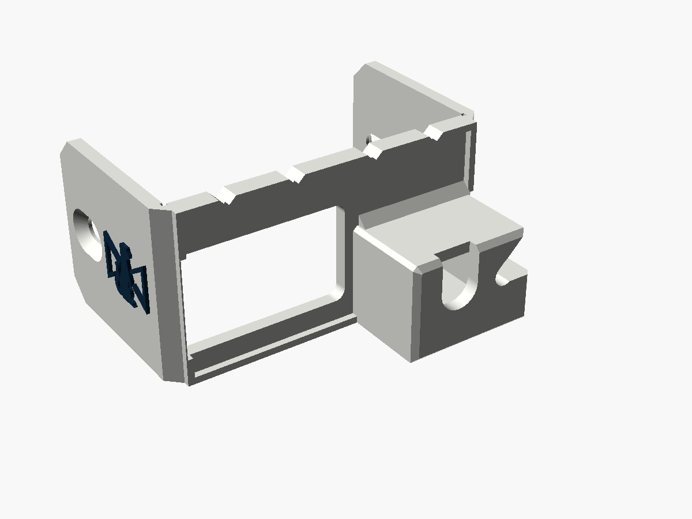
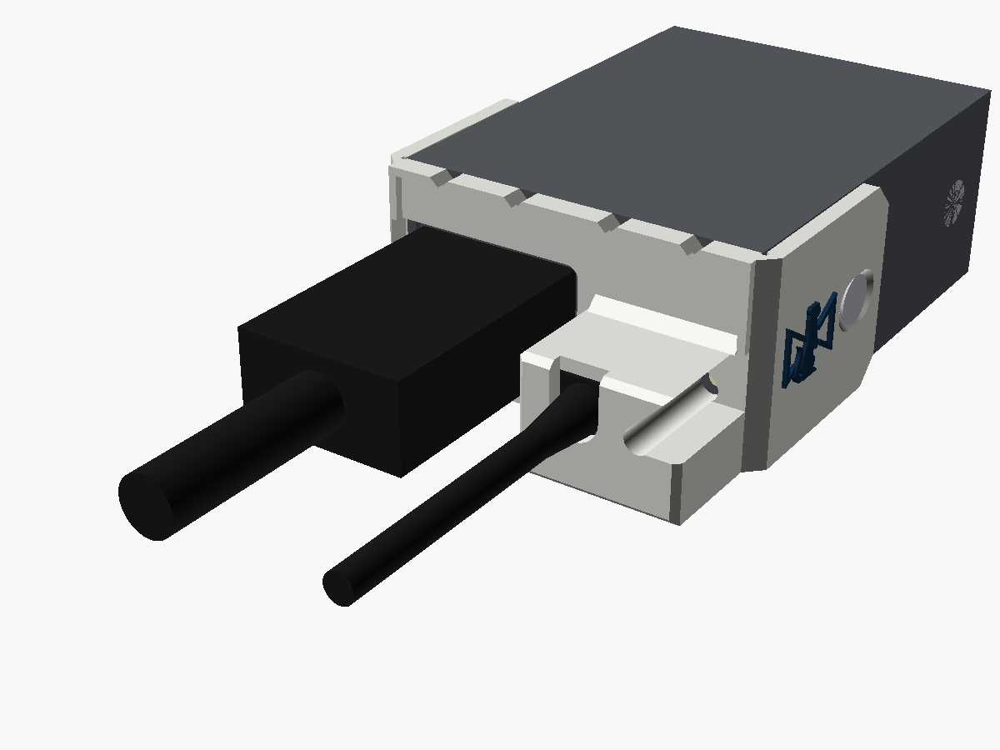
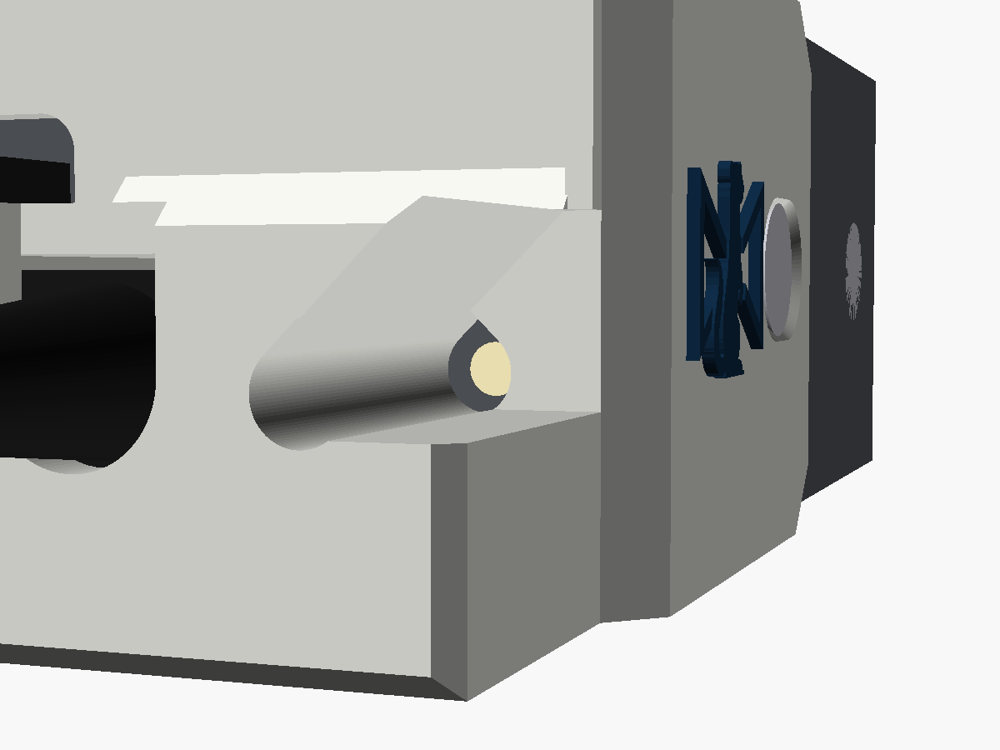
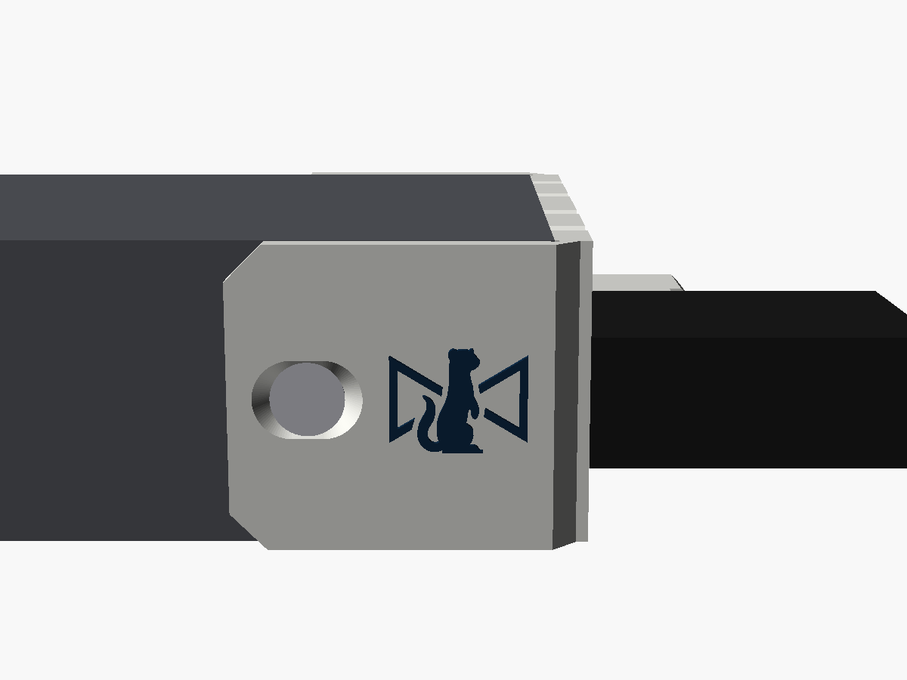
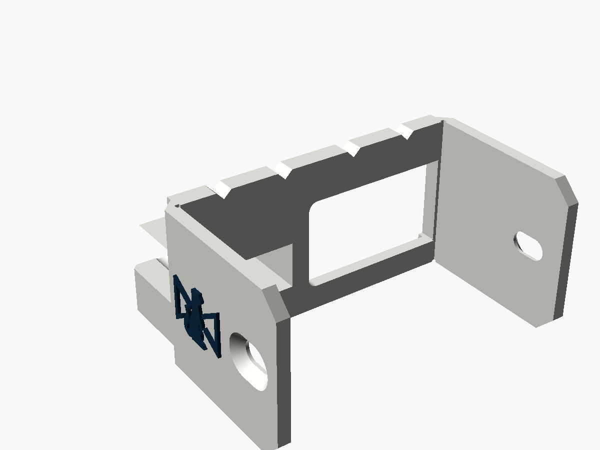

# Micro Converter micro-USB guard

A cover for the HDMI end of Blackmagic's **first one-way Micro Converters**, the
**micro-USB** models: SDI to HDMI and HDMI to SDI, from before the 3G versions moved to
USB-C. A tower round the micro-USB plug stops a tug on the cable levering the port,
which on micro-USB doesn't take much. The guard wraps round both corners of the case,
and its two arms take the case's own side screws, the pair nearest the HDMI end. The
HDMI plug goes in through a big opening beside the tower, and the power LED shows down
a light well and out of a window in the tower's side. The Stoatworks mark is on both
arms.

It is the [Micro Converter USB guard](../micro-converter-usb-guard) with the pocket,
cap and light well moved and resized for a micro-USB plug. The case, the screws and the
HDMI opening are the same, because the case is.

| | |
|---|---|
| Fits | Micro Converter SDI to HDMI and HDMI to SDI, the micro-USB models, with or without the PSU |
| Fixing | the two side screws nearest the HDMI end, swapped for M3 countersunk screws 2 mm longer |
| Takes | a micro-USB plug body up to 10.6 × 6.8 mm and 13.0 mm long (see [Before printing](#before-printing)) |
| Size | 51.1 × 24.9 mm across the end, flush with the case top and bottom. The tower stands 15.8 mm proud, and the arms run 26 mm back along the sides |
| Mass, solid PA6-GF | about 7.4 g |







Status: **v0.1, modelled and checked in software. Not printed or fitted.** The
converter's numbers come from Blackmagic's straight-on render of this end, which is to
scale. The plug's size comes from photos, and it's the number most worth checking:
see [Before printing](#before-printing).

---

## Fitting

1. Plug the micro-USB cable into the converter.
2. Take out the two side screws nearest the HDMI end, one on each side. Leave the other
   pair alone.
3. From above, slip the cable into the slot in the tower's cap. Slide the guard along
   the cable onto the end of the converter, with an arm down each side of the case,
   until the plate sits on the case's front edge and the plug body is inside the tower.
4. Put an M3 countersunk screw, 2 mm longer than the one you took out, through each
   arm's slot. Hold the guard home while you tighten them. Snug is enough.
5. Plug the HDMI cable in through the opening beside the tower.

Once fitted, the plug can't back out, because the cap sits over both ends of its
moulded body. It can't be levered either: there's a wall on each side of it and the
tower is solid underneath.

## The screws

As on the USB-C guard: M3 countersunk Phillips, two each side. **A screw that's too
long reaches the HDMI and SDI connectors inside**, so the replacement must be exactly
2 mm longer than the original, never more. Don't reuse the originals: they'd lose 2 mm
of thread. The holes are slots, ±1.2 mm along the case.

## The plug

Micro-USB mouldings vary a lot more than USB-C ones, and this pocket is sized for one
kind: the flat moulding with a "B" on it and a ribbed boot that both Blackmagic's and
Decimator's stock supplies use. From photos it's about 10.6 × 6.8 mm across and 13 mm
long, from the socket to where the boot starts. The pocket is 0.3 mm bigger all round,
and the cap sits 13.8 mm off the case's front edge: 13 mm of plug plus the end panel's
0.8 mm recess.

- **A wider or thicker moulding** won't go in. Change `plug`.
- **A longer one** won't let the guard sit home. Change `pocket_h`.
- **A shorter one** can back out by the difference before the cap stops it. Micro-USB
  only goes in about 6 mm, so more than about 1 mm short is too much: change `pocket_h`.

The cap's cable slot is 6 mm wide, which passes the cable and the start of the boot.

## The LED

The power LED is just to the right of the micro-USB port, close beside the plug's
moulding, as on the USB-C model. A light well runs down the tower over it, and opens
into a window out of the tower's side. From the LED's centre it can be seen out to 29°
off the cable's line towards the USB side, and 5–7° in other directions.

## Where the numbers came from

Blackmagic's straight-on render of this end of the SDI to HDMI (from a retailer's
listing, 1600 px) has square pixels, 30.4 px/mm, and the case comes out 45.7 ×
24.9 mm, the same as the USB-C models. The HDMI to SDI's render agrees to about 0.3 mm.

| | Here | The USB-C model |
|---|---|---|
| micro-USB / USB-C port centre | 33.3, 9.2 mm from the end's bottom-left corner | 33.8, 9.0 |
| Power LED | 41.0, 8.7 mm | 41.1, 8.5 |
| HDMI port centre | 12.3, 11.1 mm | 12.2, 11.8 |

So it's the same case with a different socket in nearly the same place. The side screws
are taken to be where they are on the USB-C models, 19.6 mm back from the front edge
at mid-height. Nothing shows otherwise, but nothing shows them either.

## Before printing

Take these with calipers:

1. **Your micro-USB plug:** the moulding's width and thickness (for `plug`), and its
   length from the socket to where the boot starts (for `pocket_h`, plus 0.8). This
   matters most.
2. **The side screws:** from the case's front edge to the centre of the screw nearest
   the HDMI end, expected 19.6 mm (the slots take ±1.2), and the length of the screw
   you take out.
3. **The port:** from the end's bottom-left corner to the micro-USB's centre, expected
   33.3 mm along and 9.2 mm up.

Then print one and fit it, and check the LED shows.

## Printing

As the USB-C guard: on its underside, as exported, no supports; 0.12 mm layers for the
mark; **PETG or PA6-GF, not PLA**; `-body.stl` plus `-logo.stl` for two colours.

## What has been checked

In software only, by `check.py` (it reads its numbers from the `.scad`):

- One closed solid, flat on the bed, 474 mm² on the bed. Flush with the case's top and
  underside, nothing inside the case, and both arms 0.2 mm clear of its sides.
- Nothing within 0.3 mm of the LED, all the way up, and it can be seen 29° off the
  cable's line towards the USB side.
- A 10.6 × 6.8 mm plug body 13.8 mm long goes in, a 4.5 mm cable passes the cap, and the
  cap is over both ends of the body.
- A 24.3 × 14.2 mm HDMI moulding reaches the port.
- An M3 flat head seats flush at both ends and the middle of each slot, and each arm is
  solid round its slot.
- The STLs re-import into OpenSCAD cleanly. Two pairs of coincident vertices at the
  plate's bottom corners come from the USB-C guard's design, and are harmless.

**Not done:** slicing, printing and fitting, and the measurements above.

## Files and rebuilding

| File | |
|---|---|
| `micro_converter_microusb_guard_v0.1.stl` | print this |
| `micro_converter_microusb_guard_v0.1-body.stl`, `-logo.stl` | the two-colour pair |
| `micro_converter_microusb_guard.scad` | the model; every number above is a named parameter at the top |
| `stoatworks_mark.scad` | the mark as one polygon, generated, do not edit |
| `check.py`, `preview.scad`, `previews.sh` | checks and pictures |

```bash
openscad -o micro_converter_microusb_guard_v0.1.stl micro_converter_microusb_guard.scad
```

```bash
python3 -I check.py
```

The two-colour STLs come from the same command with `-D 'part="body"'` or
`-D 'part="logo"'`. `check.py` needs numpy, trimesh, manifold3d, shapely, scipy,
networkx, rtree and matplotlib.

Designed with Claude.
