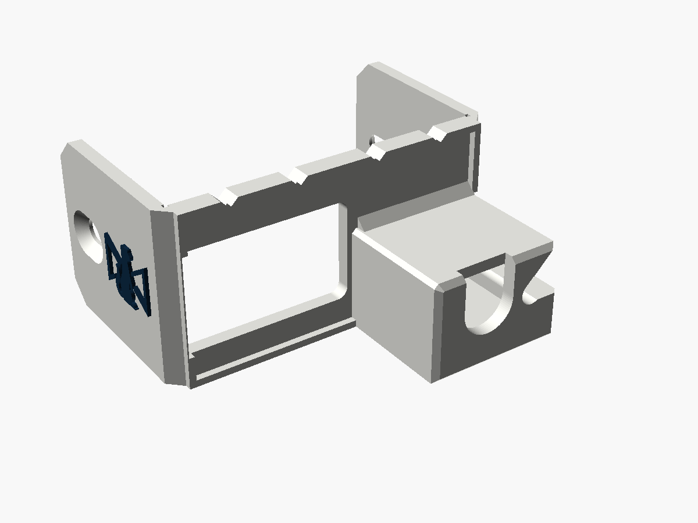
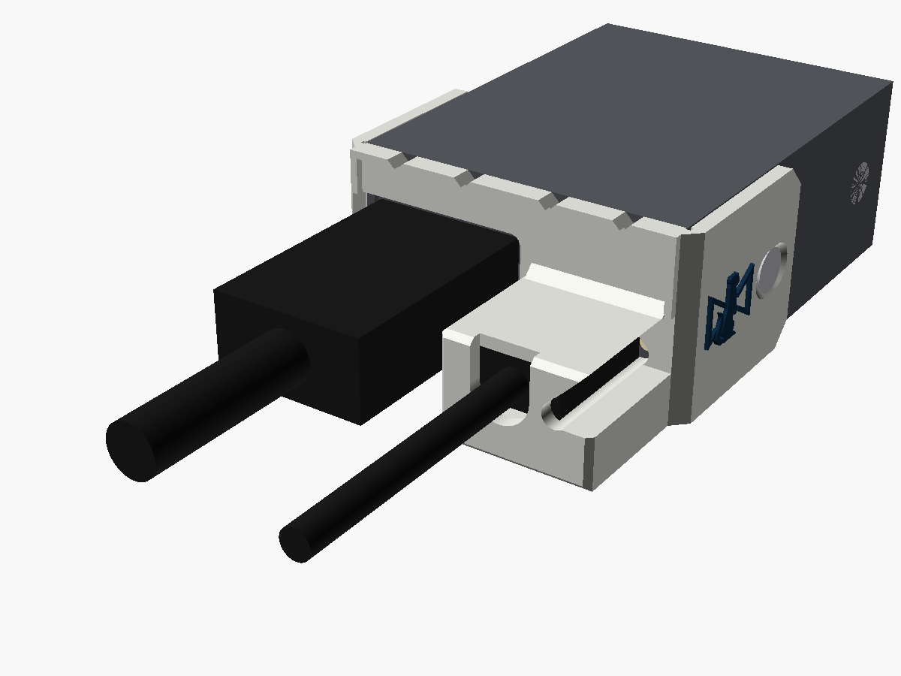
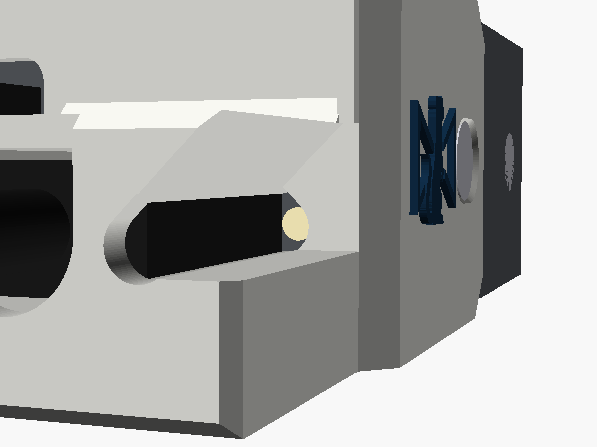
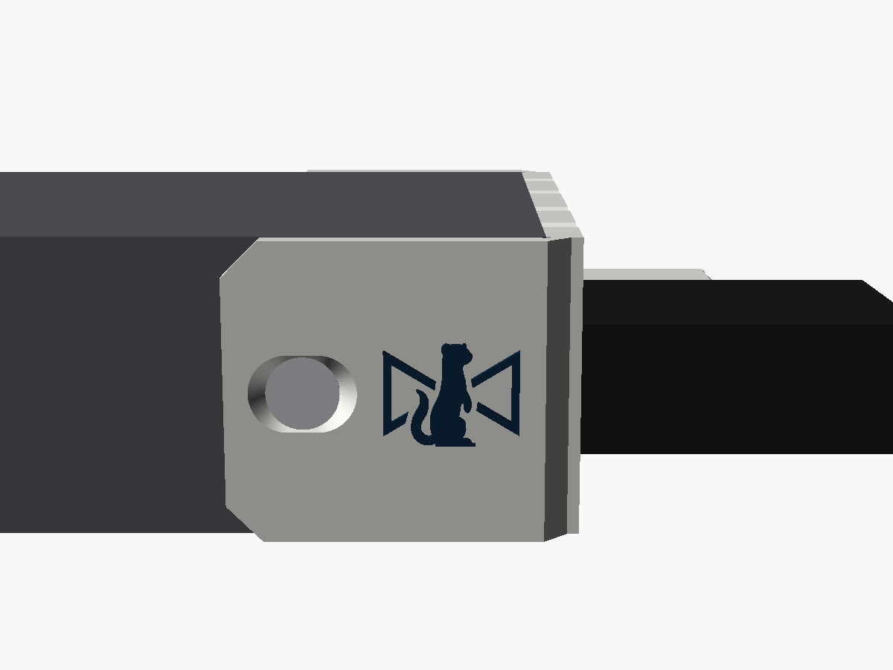
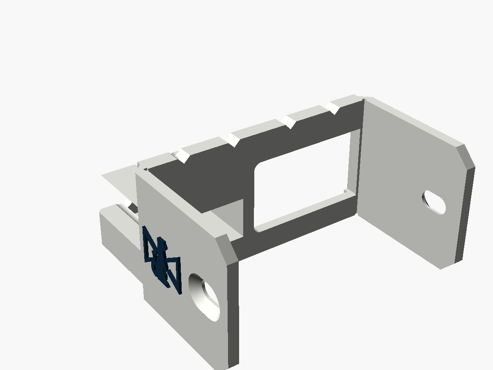

# Micro Converter USB guard

A cover for the HDMI end of Blackmagic's **one-way Micro Converters** (the USB-C
models). A tower round the USB-C plug stops a tug on the cable from levering the port.
This end has no BNC nuts to clamp a plate on, so the guard wraps round both corners of
the case. Its two arms take the case's own side screws, the pair nearest the HDMI end.
The HDMI plug goes in through a big opening beside the tower. The power LED shows down
a light well and out of a window in the side of the tower. The Stoatworks mark is on
both arms. For the earlier micro-USB models, see
[`../micro-converter-microusb`](../micro-converter-microusb).

| | |
|---|---|
| Fits | Micro Converter SDI to HDMI 3G, HDMI to SDI 3G, SDI to HDMI 12G, HDMI to SDI 12G: the USB-C models, with or without the PSU, with Blackmagic's own USB-C supply plugged in |
| Fixing | the two side screws nearest the HDMI end, swapped for M3 countersunk screws 2 mm longer |
| Size | 51.1 × 24.9 mm across the end, flush with the case top and bottom. The tower stands 20.2 mm proud, and the arms run 26 mm back along the sides |
| Mass, solid PA6-GF | about 7.9 g |







Status: **v0.1, modelled and checked in software. Not printed or fitted.** Every
number for the converter comes from Blackmagic's product renders, not from a converter
on the bench. Measure the three things in [Before printing](#before-printing), print
one, and fit it before printing more.

---

## Fitting

1. Plug the USB-C cable into the converter.
2. Take out the two side screws nearest the HDMI end, one on each side. Leave the other
   pair alone.
3. From above, slip the USB cable into the slot in the tower's cap. Slide the guard
   along the cable onto the end of the converter, with an arm down each side of the
   case, until the plate sits on the case's front edge and the plug body is inside
   the tower.
4. Put an M3 countersunk screw, 2 mm longer than the one you took out, through each
   arm's slot. Hold the guard home while you tighten them. Snug is enough.
5. Plug the HDMI cable in through the opening beside the tower.

Once fitted, the plug can't back out, because the cap sits over both ends of its
moulded body. It can't be levered either: there is a wall on each side of the plug,
and the tower is solid underneath it.

The guard is flush with the top and bottom of the case, and the tower's underside is
level with the case's, so the converter still sits flat on a desk, either way up.

## The screws

The side screws are M3 countersunk Phillips, two each side. AshTheMaker's
[Micro Converter mount](https://www.thingiverse.com/thing:5143759) takes the same
screws. It says taking out one side's pair leaves the cover attached, and it gives a
warning: **a screw that is too long reaches the HDMI and SDI connectors inside.**

Each arm is 2 mm thick and its countersink sits the head flush, so the screw needs to
be exactly 2 mm longer than the original. Measure the one you take out. If it is
M3 × 4, use M3 × 6. Never go longer, and never use the original: it would lose 2 mm
of thread.

The holes are slots, 2.4 mm long along the case. They take up the error in where the
screws were measured from (see below), so the plate can sit on the case's edge
wherever the screw actually is.

## The LED

The power LED is just to the right of the USB-C port, right beside the plug's moulded
body, under where the tower's wall would be. A light well runs down through the plate
and the whole tower over it. Above the plate, the well opens into a window out of the
tower's side, with a 45° roof that comes out through the tower's top corner.

From the LED's centre there is a clear line out to 31° off the cable's line towards
the USB-C side. In other directions it is only 4–6°, because the cap has to cover the
plug body's end, which sits right next to the LED.

The well is 3.4 mm across over a 2.1 mm LED. The LED's position comes from renders, so
hold the first print up to a powered converter.

## The HDMI plug

The opening runs from the case's own side to 1.8 mm short of the tower. It passes any
plug moulding up to 24.2 × 14.2 mm centred on the port. Nothing wider fits past the
case's own side anyway, so the guard takes nothing away from the HDMI plug.

## Where the numbers came from

Blackmagic publishes no drawings with port positions. Everything here was measured
off two independent renders, rectified with a perspective transform fitted to the
four corners of each face:

- the tech-spec "physical specifications" drawing, with the unit lying label up;
- the "six models" render on the Micro Converters landing page, with the unit standing
  on edge.

| | From | Value | The two renders agree to |
|---|---|---|---|
| End face | catalogue, 1.80 × 0.98 in | 45.72 × 24.89 mm | n/a |
| Case length | Blackmagic's top-view render, scaled by the width | 60.2 mm | n/a |
| Side screw nearest the HDMI end | both renders, as a fraction of the case length | 0.322–0.328 × 60.2 = **19.6 mm** back, at mid-height | 0.1 mm |
| USB-C port centre | both renders | 33.8, 9.0 mm from the end's bottom-left corner | 0.8 mm |
| Power LED | both renders | 41.1, 8.5 mm | 0.7 mm |
| HDMI port centre | both renders | 12.2, 11.8 mm | 0.6 mm |

- **The 12G models** were checked by differencing their tech-spec drawings against the
  3G ones. Round the screws they match. On the HDMI end they differ only in scattered
  pixels, in the USB POWER legend and inside the HDMI socket, and no port moves. So one
  guard fits all four. The HDMI to SDI 3G drawing matches the SDI to HDMI 3G one exactly
  on the end and round the screws.
- **The plug body** is Blackmagic's own USB-C supply: under 13.5 × 7.5 mm, and 18.2 mm
  from the port to where the cap must sit. These numbers come from the BiDi guard,
  which took them from dj12bas's part. They describe Blackmagic's plug, not anyone's
  design.
- **The end panel looks recessed** about 0.8 mm inside the case's front edge, judging
  by the shadow line in the renders. The guard's plate sits on that edge, and the
  18.2 mm is measured from it, so the plug can move up to that much before the cap
  stops it. The plug will fit whatever the recess is. If a real converter shows the
  recess, lower `pocket_h` by it.

## Before printing

Three measurements settle what the renders cannot. Take them with calipers on one
converter:

1. **From the case's front edge to the centre of the side screw nearest the HDMI end**:
   expected 19.6 mm. The slot takes ±1.2 mm. Beyond that, change `screw_z`.
2. **The case's width**: expected 45.7 mm. Each arm sits 0.2 mm off the case, and the
   screws pull it in. If the case is wider than 46.1 mm, change `case_w`.
3. **The length of the screw you take out**, for the replacement (see above).

Then print one and check that the USB-C plug sits square in the tower, the cap clears
the plug body, and the LED shows.

## Printing

- **On its underside, as exported.** The STL is already turned: the converter's
  underside is on the bed, and so is every part of the guard. No supports. The
  roof over the HDMI opening bridges 25 mm and the roof over the plug pocket 13.6 mm.
  The well and window have 45° roofs.
- 0.12 mm layers for the mark, which stands on the arms' upright faces.
- **PETG or PA6-GF, not PLA.** The screws clamp the arms, and PLA creeps under a
  constant load. The converters also run warm.
- **Two colours:** `-body.stl` plus `-logo.stl` (same coordinates). Load both as one
  object with two parts and give the logo its own filament.

## What has been checked

In software only, by `check.py` (it reads its numbers from the `.scad`):

- One closed solid. It lies flat on the bed as exported, with 572 mm² on the bed.
- Flush with the case's top and underside. Nothing inside the case, and the arms 0.2 mm
  clear of its sides.
- Nothing within 0.3 mm of the LED, all the way up. It can be seen from 31° towards the
  USB-C side and 4–6° in other directions, from its centre.
- A 13.5 × 7.5 × 18.2 mm plug body goes in, its 4.5 mm cable passes the cap, and the cap
  is over both ends of the body.
- A 24.2 × 14.2 mm HDMI moulding reaches the port.
- An M3 flat head seats flush at either end and the middle of each slot, and each arm
  is solid round its slot.
- The STLs re-import into OpenSCAD cleanly, the test the BiDi guard's countersinks
  once failed.

`check_sections.png` shows the guard against the converter at the plate, through the
tower, and through the screws.

**Not done:** slicing, printing and fitting. In particular:

- the three measurements above;
- whether your USB-C cable's plug fits (sized for Blackmagic's own supply);
- whether the LED window lines up with a real converter.

## What makes it its own design

It was written from scratch in OpenSCAD. No downloaded part was used: there wasn't one
for this end of these converters. The only borrowed numbers are Blackmagic's plug body
(above). From the BiDi guard it keeps the family look:

- the raised 1 × 1 mm lip round the outer face;
- four 90° V-notches, here along the top edge, clear of the tower;
- chamfered edges;
- a light well over the power LED;
- the mark, 10.9 × 8.4 mm, raised 0.5 mm.

It is new in wrapping the case: a 45° bevel round each upright corner runs into an arm
that takes a case screw.

## Other Blackmagic converters

- **BiDirectional SDI/HDMI 3G:** its USB-C port is on the SDI end, between BNCs with
  nuts. See [`../bidi-usb-guard`](../bidi-usb-guard).
- **The 2110 IP range** (checked 2026-10-22): **none is powered over USB-C.** The four
  2110 IP Minis take a locking 5.5 mm 12 V jack or PoE, and their USB-C is only for
  setup and firmware. The rest are rack or half-rack units on IEC mains. So none needs
  this kind of tower. Two have a different exposed plug, and would need a different
  design:
  - **2110 IP Mini IP to HDMI** (and its SFP version): the HDMI end carries an
    unlatched HDMI lead, often a heavy one to a screen. Blackmagic's end-panel photo
    shows two Phillips screws either side of the HDMI port, which could anchor an HDMI
    clamp.
  - **2110 IP Presentation Converter:** the rear USB-C "PC video in" feeds a laptop and
    stays plugged in for the whole show.
- **Mini Converter SDI Distribution, SDI Distribution 4K and Sync Generator:** powered
  by an unlatched 12 V barrel jack in a corner of a BNC end. See
  [`../mini-converter-power-guard`](../mini-converter-power-guard) (a cover across the
  end) and [`../mini-converter-power-clamp`](../mini-converter-power-clamp) (a longer
  strain relief on one side).

## Files and rebuilding

| File | |
|---|---|
| `micro_converter_usb_guard_v0.1.stl` | print this |
| `micro_converter_usb_guard_v0.1-body.stl`, `-logo.stl` | the two-colour pair |
| `micro_converter_usb_guard.scad` | the model; every number above is a named parameter at the top |
| `stoatworks_mark.scad` | the mark as one polygon, generated, do not edit |
| `check.py`, `preview.scad`, `previews.sh` | checks and pictures |

```bash
openscad -o micro_converter_usb_guard_v0.1.stl micro_converter_usb_guard.scad
```

```bash
python3 -I check.py
```

The two-colour STLs come from the same command with `-D 'part="body"'` or
`-D 'part="logo"'`. `check.py` needs numpy, trimesh, manifold3d, shapely, scipy,
networkx and matplotlib (`../requirements.txt`). The mark is the BiDi guard's, generated from the Stoatworks logo by a script that isn't
in this repo.

Designed with Claude.
