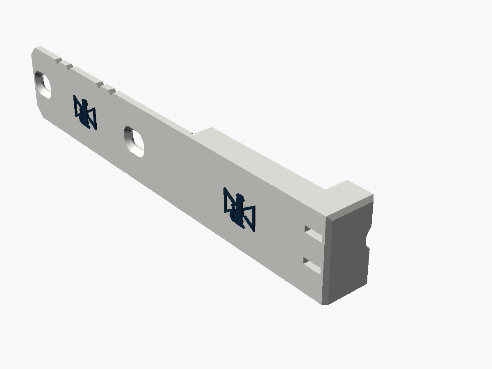
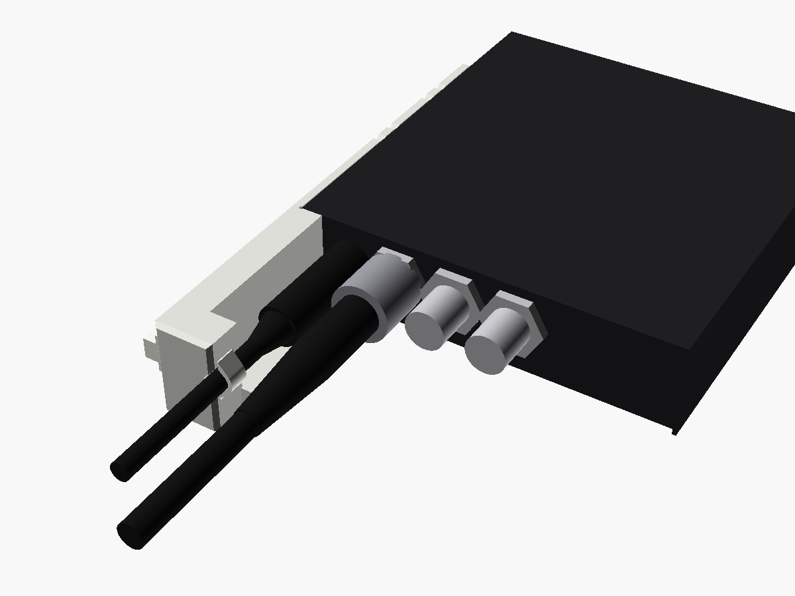
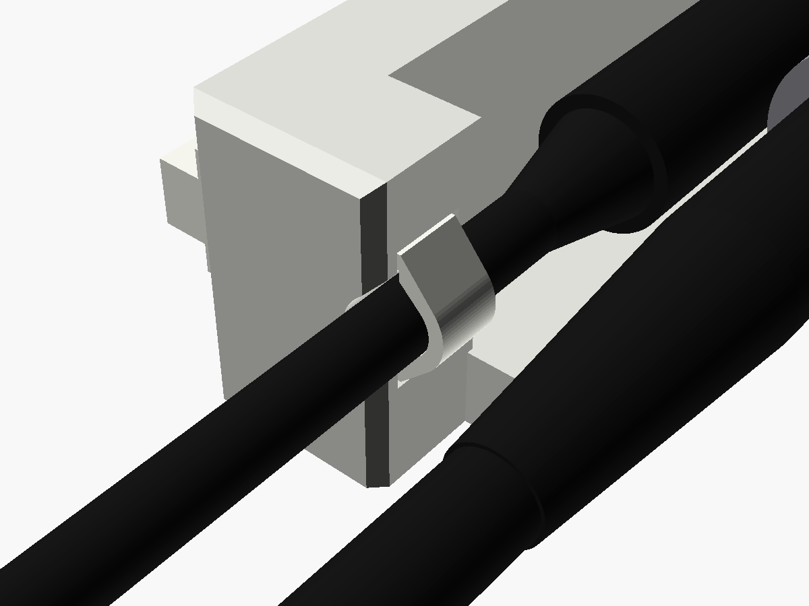
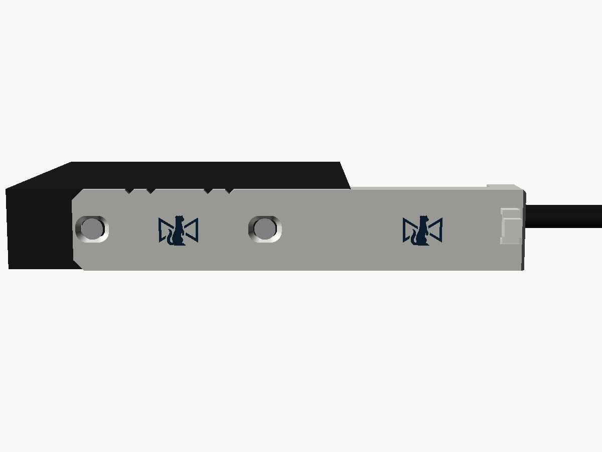
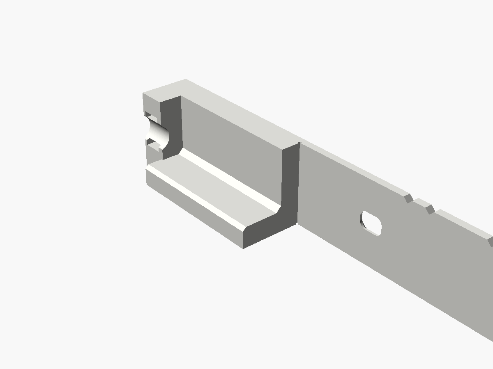

# Mini Converter power clamp

A strain relief for the 12 V lead of Blackmagic's **Mini Converter SDI Distribution**,
**SDI Distribution 4K** and **Sync Generator**. Their power jack is a plain, unlatched
barrel socket in one corner of a BNC end, and a DA or a sync generator is the last box
anyone wants to lose power mid-show. The clamp takes the two case screws on the jack's
side. From that arm a spine runs out beside the plug, with a floor under it, to a block
past the plug's moulding. The cable is tied into a groove in the block, on the jack's
own axis, so a tug on the lead pulls on the case's screws, not on the jack. The
Stoatworks mark is on the outer face, twice.

| | |
|---|---|
| Fits | Mini Converter SDI Distribution, SDI Distribution 4K, Sync Generator: the power end |
| Fixing | the two side screws on the jack's side, swapped for M3 countersunk screws 2 mm longer |
| Takes | plug mouldings up to 13 mm across and 40 mm long including the boot; cables 3.5–6 mm; one cable tie up to 5 × 1.5 mm |
| Size | flush with the case's top and underside; 2.2 mm proud of its side (2.7 at the marks); 49 mm out from the end; the arm runs 78 mm back along the side |
| Mass, solid PA6-GF | about 18.0 g |







For a shorter part that covers the whole end and takes a screw each side, see
[`../mini-converter-power-guard`](../mini-converter-power-guard).

Status: **v0.1, modelled and checked in software. Not printed or fitted.** Every
number for the converters comes from Blackmagic's product renders, not from a
converter on the bench. Measure the things in [Before printing](#before-printing),
print one, and fit it before printing more.

---

## Fitting

Do this with the converter unpowered.

1. Take out the two side screws on the jack's side: the side nearest the POWER +12V
   socket. Leave the other side's pair alone; they hold the cover on meanwhile.
2. Hold the clamp to the case: the arm flat on that side, flush with the top and the
   underside, and the spine's back against the case's front edge at the corner. Put an
   M3 countersunk screw, 2 mm longer than the one you took out, through each slot. Push
   the clamp towards the power end while you tighten them, so it sits hard on the
   case's edge. Snug is enough.
3. Plug the 12 V lead in, down the channel.
4. Lay the cable in the groove in the block. From the outer face, push a cable tie in
   through one tunnel, round the cable, and back out through the other. Close it on
   the outer face. Pull it snug, not tight: it only has to stop the cable sliding.
   Leave the cable slack between the plug and the block.

From then on, a pull on the lead stops at the tie. The plug only carries its own
weight and a slack bit of cable. A reusable cable tie with a release tab is kinder to
hire stock than one you have to cut off.

## The screws

Blackmagic's manual (the SDI Distribution 4K's firmware section) calls the side
screws M3 Phillips, four of them, two per side, holding the cover to the frame. In
Blackmagic's renders the heads sit flush, so they are taken to be countersunk. The
arm is 2 mm thick and its countersinks sit an M3 flat head just under flush, so each
screw needs to be **exactly 2 mm longer than the original**. Measure the one you take
out. Don't reuse the originals: they would lose 2 mm of thread.

Before fitting the clamp, run a longer screw into the empty hole on its own. It has to
go fully home without forcing. If it stops short, something inside is in the way (the
hole may be blind, or a part on the board may sit behind it), and the clamp needs
shorter screws or a thinner arm (`arm_t`).

The holes are slots, 3.6 mm across with 3 mm of travel along the case. They take up
the error in where the screws were measured from (see below): ±1.5 mm along the case,
±0.6 mm up and down. The far screw measures about 1 mm higher than the near one. If your converter's heads are pan heads after all, they will
still clamp, but stand about 2 mm proud.

## The plug, the cable and the tie

- **The plug's moulding** gets a channel 13 mm across round the jack's axis: the spine
  on the outer side, the floor underneath, open above and on the BNC side. It must
  finish before the block, 40 mm out from the case's edge, boot included. For a longer
  one, raise `tie_z`.
- **The groove** is sized so a 4.5 mm cable lies exactly on the jack's axis. Others lie
  in the bottom of it, a 3.5 mm one 0.5 mm off the axis and a 6 mm one 0.8 mm off, well
  within what the slack takes up. Every size stands at least 1 mm proud of the block,
  so the tie grips the cable, not the block. For an exact fit, set `cable_d`.
- **The tie** goes through two tunnels in the block, one opening just above the cable
  and one just below, and closes on the outer face. That keeps the tie's buckle on the
  outside of the case, away from the BNCs.

## The BNCs next door

On the Sync Generator, the REF OUT nearest the jack is only 12.3 mm from it, centre to
centre. A BNC plug's coupling sleeve, 14.3 mm across, comes to within 5 mm of the
jack's axis. Nothing fits between the two plugs. So the clamp keeps entirely to the
jack's outer side and below the plug, and checks with at least 1.2 mm to spare against
a BNC plug, its boot and its coax in that REF OUT, with the BNCs anywhere from 10.9 to
13.9 mm up. On the two DAs the nearest BNC (SDI IN) is 17.4 mm from the jack, and the
clamp has 5.5 mm to spare.

The DC plug itself is another matter, clamp or no clamp. On the Sync Generator a plug
moulding more than about 10 mm across will rub a BNC plug in the nearest REF OUT.
Blackmagic's own supply presumably fits. Check any other lead you mean to use.

## Blackmagic's own tie point

The case has a cable tie point at this corner: a slot in the top cover, just behind the
end, above the jack. The clamp leaves it free. It also leaves free the small round hole
in the end panel between the jack and the nearest BNC.

## Where the numbers came from

Blackmagic publishes no drawings with port positions. Everything here was measured off
Blackmagic's renders:

- the tech-spec "physical specifications" drawings of the SDI Distribution and the
  Sync Generator (two separate renders, with the unit lying label up), rectified with
  a perspective transform fitted to the case's edges;
- the top views at the head of each model's tech specs, which are straight down;
- the close-up of a Mini Converter's end on the Mini Converters landing page (another
  model, same case), nearly straight on.

| | From | Value | Agreement |
|---|---|---|---|
| End | catalogue, 3.63 × 0.90 in | 92.2 × 22.9 mm | n/a |
| Case length, without the BNCs | a camera fitted to the render's corners; the top views | 96.9 mm (96.2–97.6) | see below |
| Side screws | both renders, as a fraction of the case length | 0.248–0.249 and 0.747–0.749, so **24.1 and 72.5 mm** back from the case's edge; about 11.3 mm up (near) and 12.3 mm (far) | 0.15 mm between the renders |
| DC jack | the close-up, and the top views' tie slot | **11.9 mm** from the side, **12.4 mm** up | directly under the tie slot |
| BNCs' height | the close-up | about 12.4 mm up, the same as the jack | ±1.5 mm: the renders disagree |
| End panel recess | the far side wall's inner face, showing in both renders | about 1.5 mm behind the case's edge | |
| Nearest BNC | the top views | SDI Distribution and 4K: 29.3 mm from the side; Sync Generator: 24.1 mm | the two DAs match exactly |
| Cable tie point | the top views | a 4.2 × 2.9 mm slot, 11.9 mm from the side, 3.9 mm behind the end | |

- **The "4.80 in" is not the case.** Blackmagic's drawings give the SDI Distribution
  as 4.80 in long and the Sync Generator as 4.84 in, and retailers turn that into
  123 × 92 × 23 mm. That length includes the BNCs at both ends. A camera fitted to the
  render's corners puts the case itself at 97.6 mm (1.7 px error; forcing 122 mm leaves
  8 px), and the top view, scaled by tip-to-tip = 4.80 in, makes it 96.2 mm. It matters
  because the screws sit at a quarter and three quarters of the case: 24 and 72 mm,
  not 30 and 91.
- **The jack** measured 10.9 mm from the side and 12.9 mm up on both renders, on the
  plane of the case's edge. The end panel sits behind that plane, which shifts things
  at the renders' angle, so v0.1 first corrected it to 12.0 and 11.6. Blackmagic's
  close-up of a Mini Converter end, nearly straight on, settles it: the jack sits
  directly under the tie slot (11.9 mm from the side in the top views) and 12.4 mm up,
  4.4 mm above the small hole beside it, as in the renders.
- **The BNCs' height** is the least certain number. In the close-up they sit at about
  the jack's height. Fitting a camera to the renders put them higher, but that fit
  goes wrong once it reaches out in front of the case, where the BNCs are. So the
  checks try them at 10.9, 12.4 and 13.9 mm.
- **The SDI Distribution 4K** has the same case and its top view matches the SDI
  Distribution's exactly (BNC rows, tie slot), so one clamp fits all three.
- **The BNC plug** checked against is a generic 75 Ω crimp plug: a 14.3 mm sleeve out to
  32 mm, a 10 mm body and boot to 55 mm, then 8 mm coax. The nut is 15.4 mm across its
  corners.

## Before printing

Take these with calipers on one converter:

1. **The side screws:** from the case's front edge (the cover's edge round the end, not
   the recessed panel) to the centre of each of the two screws on the jack's side:
   expected 24.1 and 72.5 mm. Their height off the underside: expected about 11.3 and
   12.3 mm. The slots take ±1.5 mm along and ±0.6 mm up and down round 11.8; beyond
   that, change `screw_z` or `screw_y`.
2. **The jack:** from the case's side to its centre, expected 11.9 mm, and from the
   underside, expected 12.4 mm. The channel has about 1 mm to spare round a 11 mm
   moulding; the groove wants the cable on the jack's axis, so if the jack is more than
   about 1 mm off, change `jack`.
3. **The screw you take out:** its length, for the replacement, and that one 2 mm longer
   runs fully home in the empty hole (see [The screws](#the-screws)).
4. **Your 12 V lead:** the moulding's length from the panel, boot included (under 40 mm,
   or raise `tie_z`), its width (under 13 mm), and the cable's diameter (for `cable_d`).

Then print one and fit it.

## Printing

- **On its underside, as exported.** The STL is already turned: the converter's
  underside is on the bed, and so is every part of the clamp. No supports. It is
  127 mm long on the bed. The tie tunnels' roofs bridge 5.4 mm; the groove has a 45°
  roof.
- 0.12 mm layers for the marks, which stand on the outer face.
- **PETG or PA6-GF, not PLA.** The screws clamp the arm, and PLA creeps under a
  constant load.
- **Two colours:** `-body.stl` plus `-logo.stl` (same coordinates). Load both as one
  object with two parts and give the logo its own filament.

## What has been checked

In software only, by `check.py` (it reads its numbers from the `.scad`):

- One closed solid, with no near-duplicate vertices. It lies flat on the bed as
  exported, with 1068 mm² on the bed.
- Flush with the case's top and underside. Nothing inside the case, and the arm 0.2 mm
  clear of its side. It bears on the case's edge round the corner.
- A plug moulding 13 mm across and 40 mm long fits, and the jack's opening is clear.
- A BNC plug in the nearest BNC is clear, with the BNCs anywhere from 10.9 to 13.9 mm
  up: on the Sync Generator with at least 1.2 mm to spare, on the two DAs 5.5 mm.
- Cables from 3.5 to 6 mm lie in the groove, within 0.8 mm of the jack's axis and at
  least 1 mm proud for the tie. Both tie tunnels are clear, and the tie's loop round a
  6 mm cable stays clear of the Sync Generator's BNC boot.
- An M3 flat head seats at both ends and the middle of each slot, and a screwdriver
  reaches each screw.
- Blackmagic's tie point and the small hole beside the jack are left free.
- The STLs re-import into OpenSCAD cleanly.

`check_sections.png` shows the clamp against the converter through the channel, through
the tie block, and from above at the jack's height.

**Not done:** slicing, printing and fitting. In particular, the measurements above,
and whether the longer screws go home.

## What makes it its own design

It was written from scratch in OpenSCAD. It keeps the family look of the other
converter guards: chamfered corners, four 90° V-notches (here along the arm's top
edge), countersunk slots as on the Micro Converter guard, and the mark, 10.9 × 8.4 mm,
raised 0.5 mm, on the outer face. There's no raised lip: no plate faces outwards for
one to go round.

It is new in tying the cable sideways. The tie goes through the block and closes on
the outside, so nothing reaches across to the BNC side.

## Other Mini Converters

Most of the range shares this case, and some of the renders (the HDMI to SDI 6G's,
for one) put the power jack in the same corner. What sits beside the jack differs
(HDMI, BNCs, audio), and none of the others has been checked. Compare its nearest
connector against the clamp's sections before trying one.

## Files and rebuilding

| File | |
|---|---|
| `mini_converter_power_clamp_v0.1.stl` | print this |
| `mini_converter_power_clamp_v0.1-body.stl`, `-logo.stl` | the two-colour pair |
| `mini_converter_power_clamp.scad` | the model; every number above is a named parameter at the top |
| `stoatworks_mark.scad` | the mark as one polygon, generated, do not edit |
| `check.py`, `preview.scad`, `previews.sh` | checks and pictures |

```bash
openscad -o mini_converter_power_clamp_v0.1.stl mini_converter_power_clamp.scad
```

```bash
python3 -I check.py
```

The two-colour STLs come from the same command with `-D 'part="body"'` or
`-D 'part="logo"'`. To change the screws, the jack or the lead, add `-D
'screw_z=[24.6,73.0]'`, `-D 'jack=[12.4,11.6]'`, `-D 'cable_d=4'` or `-D 'tie_z=44'`,
and re-run `check.py` (which reads the `.scad` file, so edit the defaults there for it
to check the new values). `check.py` needs numpy, trimesh, manifold3d, shapely, scipy,
networkx and matplotlib (`../requirements.txt`),
and OpenSCAD for the re-import check.

Designed with Claude.
