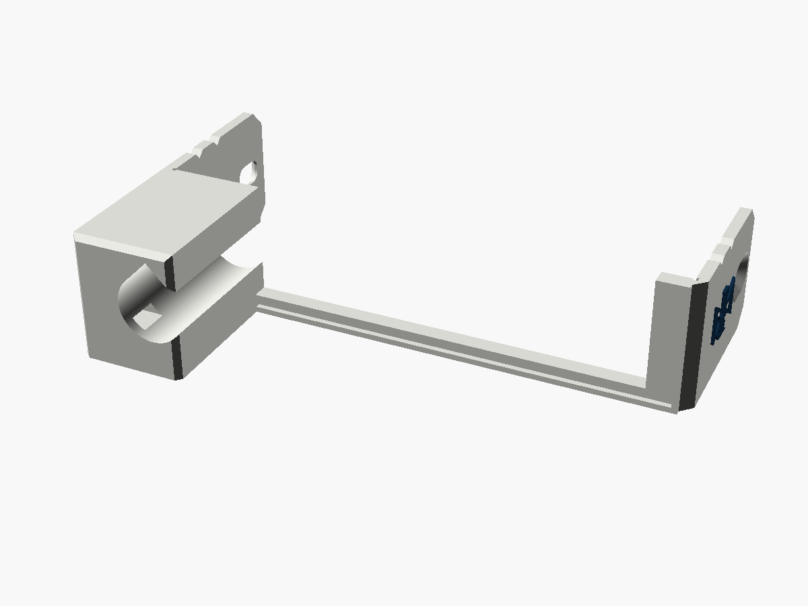
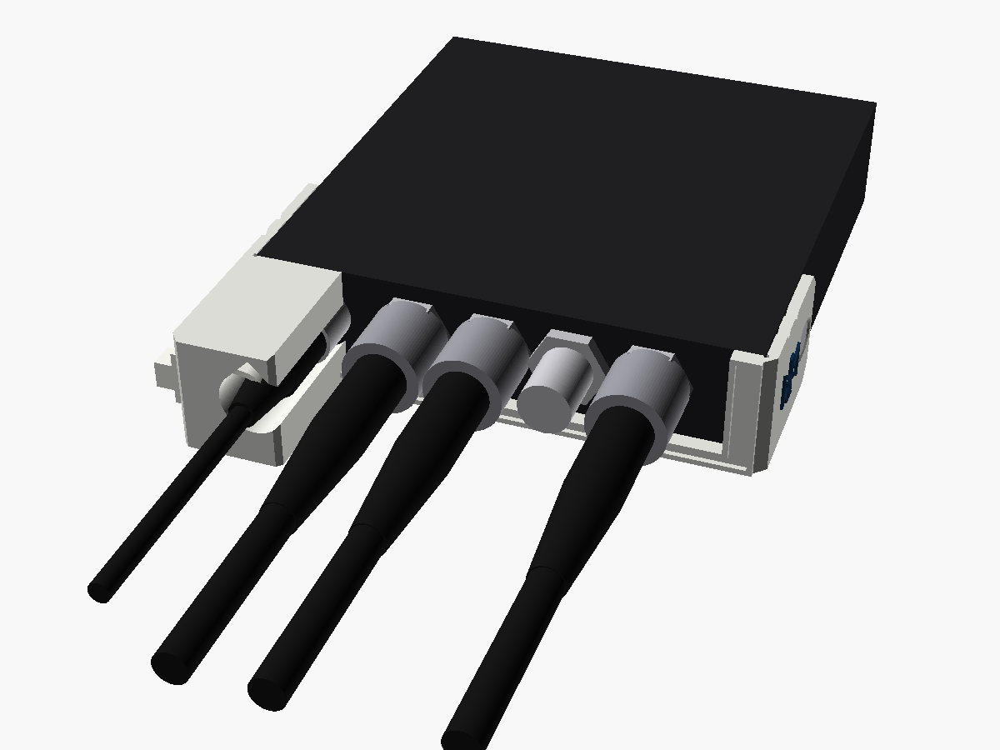
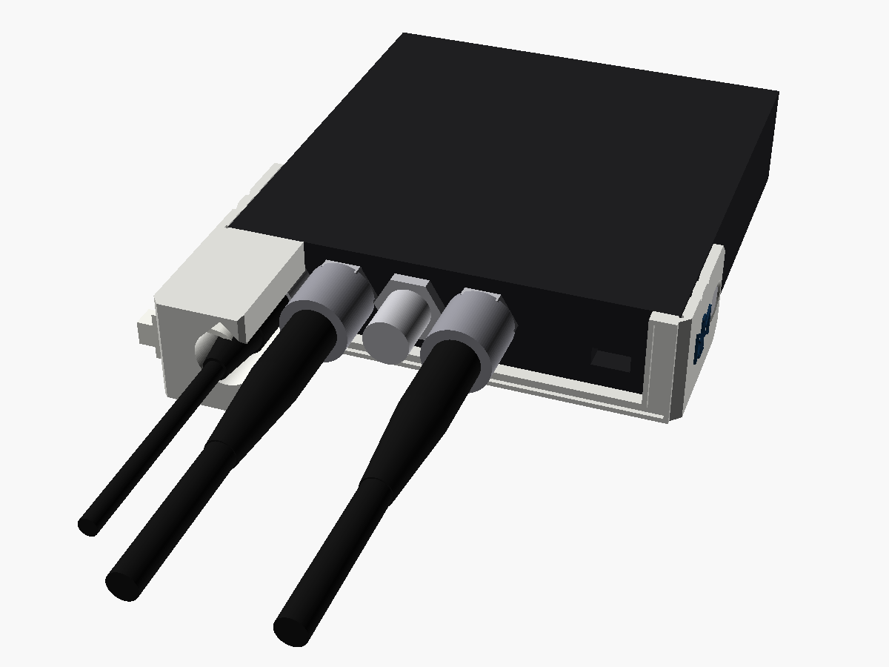
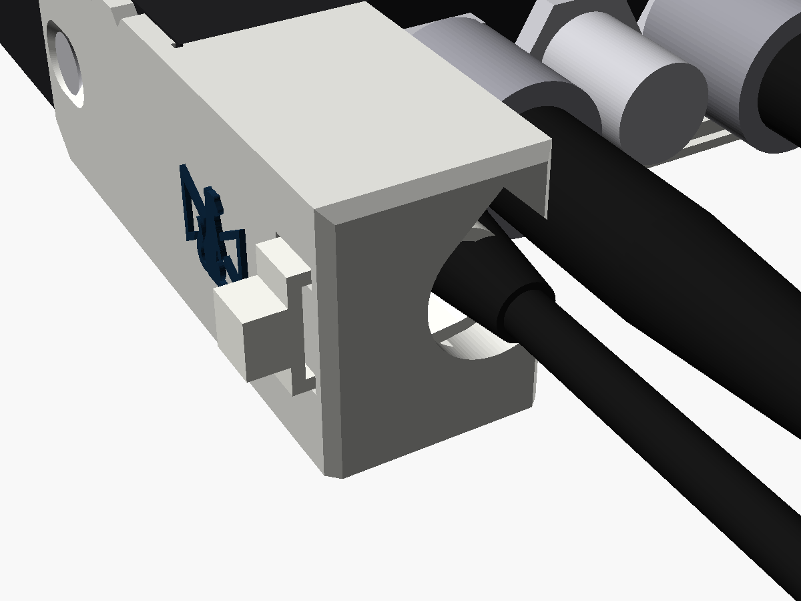
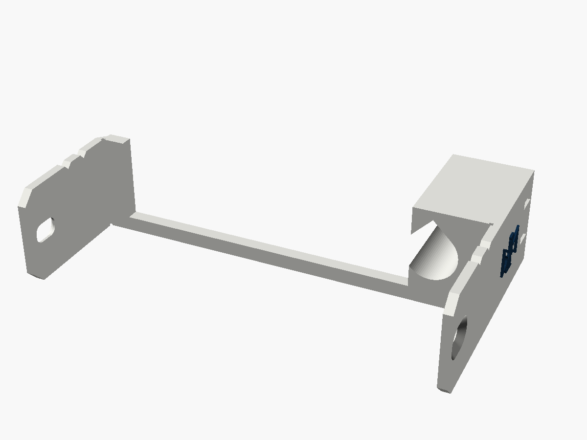
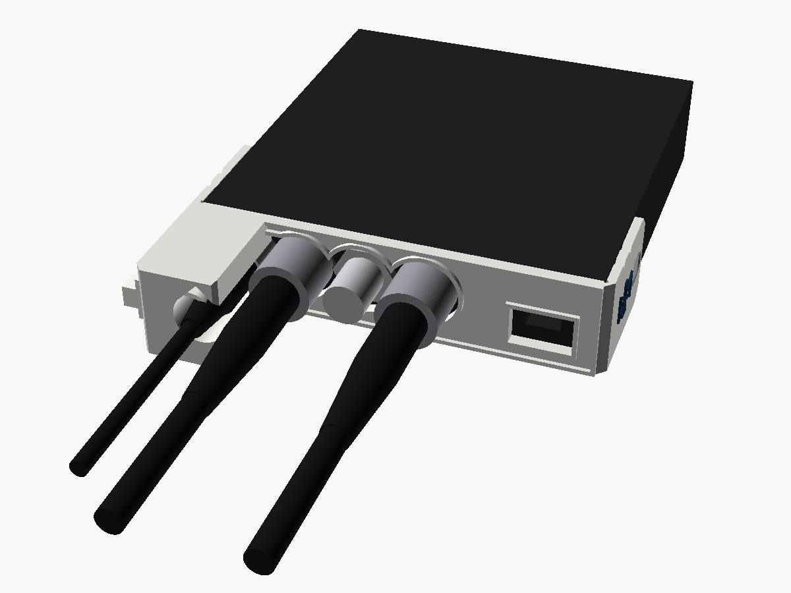

# Mini Converter power guard

A cover for the power end of Blackmagic's **Mini Converter SDI Distribution**, **SDI
Distribution 4K** and **Sync Generator**, in the manner of the BiDi guard. A plate
spans the whole end and wraps round both corners into short arms, each taking the
case screw nearest the end. A tower round the 12 V plug holds it straight. A cable tie
through the top of the tower holds the plug's boot, so a tug on the lead pulls on the
case's screws, not on the jack, which is a plain unlatched barrel socket. One part fits
all three converters. The Stoatworks mark is on the tower's outer face and on the far
arm.

It is the compact sibling of the [power clamp](../mini-converter-power-clamp): 28 mm
out from the end instead of 49, and arms 30 mm back along both sides instead of one arm
78 mm back along one.

| | |
|---|---|
| Fits | Mini Converter SDI Distribution, SDI Distribution 4K, Sync Generator: the power end |
| Fixing | the side screw nearest the power end on each side, swapped for M3 countersunk screws 2 mm longer |
| Takes | 12 V plug mouldings and locking collars up to 12 mm across, any length; one cable tie up to 5 × 1.5 mm |
| Size | flush with the case's top and underside; 2.2 mm proud of each side (2.7 at the marks); the tower stands 28 mm out from the end; the arms run 30 mm back |
| Mass, solid PA6-GF | about 13.8 g (15.1–15.4 g with `bnc_holes`) |







Status: **v0.1, modelled and checked in software. Not printed or fitted.** Every
number for the converters comes from Blackmagic's pictures, not from a converter on
the bench. Measure the things in [Before printing](#before-printing), print one, and
fit it before printing more.

---

## The BNC side: a window, or a hole each

On these converters the BNCs fill most of the end's height, their nuts within about
3 mm of the top cover, and their height is the one number Blackmagic's pictures don't
pin down (see below). So the guard comes two ways:

- **As exported (`bnc_holes = false`): one window** over all the BNCs and the Sync
  Generator's USB port, open at the top, with a 3.4 mm rail along the bottom joining
  the tower to the far arm. It fits whatever the BNCs' height, from 10.9 to 13.9 mm
  up, and one part fits all three converters.
- **`bnc_holes = true`: a hole per BNC** and a 2.4 mm strip across the top, like the
  BiDi guard. It covers the whole end, with a window for the USB port and the two
  small holes. It needs the BNCs' height measured (`bnc_y`) and the model set
  (`model = "da"` or `"sync"`), because the two models' BNCs are in different places.
  No STL is exported for it until `bnc_y` has been measured.



## Fitting

Do this with the converter unpowered.

1. Take out the side screw nearest the power end on each side. Leave the other two;
   they hold the cover on meanwhile.
2. Slide the guard onto the power end, an arm down each side, until the plate sits on
   the case's front edge. Put an M3 countersunk screw, 2 mm longer than the one you
   took out, through each arm's slot. Push the guard towards the end while you tighten
   them, so the plate sits hard on the edge. Snug is enough.
3. Push the 12 V plug into the jack through the tower, from the front.
4. From the outer face of the tower, push a cable tie in through one tunnel, round the
   plug's boot, and back out through the other. Close it on the outer face. Pull it
   snug: it holds the boot, so the plug cannot be pulled out.

A reusable cable tie with a release tab is kinder to hire stock than one you have to
cut off.

## The screws

Blackmagic's manual (the SDI Distribution 4K's firmware section) calls the side screws
M3 Phillips, two per side. In Blackmagic's renders the heads sit flush, so they are
taken to be countersunk. Each arm is 2 mm thick and its countersink sits an M3 flat
head just under flush, so each screw needs to be **exactly 2 mm longer than the
original**. Measure the one you take out. Don't reuse the originals: they would lose
2 mm of thread.

Before fitting the guard, run a longer screw into the empty hole on its own. It has to
go fully home without forcing. If it stops short, something inside is in the way, and
the guard needs shorter screws or thinner arms (`arm_t`).

The holes are slots, 3.6 mm across, with ±1.5 mm of travel along the case and ±0.4 mm
up and down, to take up the error in where the screws were measured from.

## The plug and the tie

- **The pocket** is 12 mm across and runs right through the tower, so the plug goes in
  from the front, whatever its length. Blackmagic's current supply ("Power Supply -
  Converters 12V12W Locking", 5.5 × 2.5 mm) has a knurled locking collar about 10.4 mm
  across, which fits. On these plain jacks the collar doesn't lock anything.
- **The tie** goes round whatever is at the top of the tower: on Blackmagic's plug,
  the end of the body or the start of the ribbed boot. Tied round the boot it cannot
  slide, which is the point. If your plug's boot starts further out than 21 mm from
  the case's edge, raise `tower_h` so the tie lands on it.
- **The tie pulls the boot against the pocket's outer side**, 1.5–2.5 mm off the jack's
  axis for a boot 7–9 mm across. The boot takes that up. A bare 3.5 mm cable would sit
  4 mm off, so tie the boot, not the cable.
- The pocket is open on the BNC side. On the Sync Generator the nearest REF OUT is
  only 12.3 mm from the jack, and there is no room for a wall between the two plugs.

## The BNCs and the USB port

With the window, the guard keeps out of the BNCs' way entirely. The checks put a BNC
plug (14.3 mm sleeve, boot and coax) and a 1/2 in nut in every BNC on both models, at
10.9, 12.4 and 13.9 mm up. Everything is clear: just at 10.9, with 1.1–1.5 mm to spare
at 12.4, and 0.5–3.0 mm at 13.9. The Sync Generator's mini-B USB port is inside the
window, with room for a 12 × 8 mm plug. So are the two small holes in the panel, one
beside the jack and one beside the USB port.

With `bnc_holes`, each hole is 16.2 mm across, which leaves 0.6 mm round a 1/2 in nut
at the measured height. That is why `bnc_y` has to be measured, not guessed.

Blackmagic's own cable tie point (a slot in the top cover above the jack) is covered
by the tower. The guard's tie replaces it.

## Where the numbers came from

The method and most of the numbers are the power clamp's: see its
[Where the numbers came from](../mini-converter-power-clamp/README.md#where-the-numbers-came-from).
In short:

| | Value | From |
|---|---|---|
| End | 92.2 × 22.9 mm | catalogue, 3.63 × 0.90 in |
| Case length | about 97 mm, without the BNCs | a camera fitted to the renders; the "4.80 in" includes the BNCs |
| Near side screws | 24.3 mm back from the case's edge, 11.3 mm up | a camera fitted to each render; 24.1 by the face-by-face method |
| DC jack | 11.9 mm from the side, 12.4 mm up | Blackmagic's close-up of a Mini Converter end; directly under the tie slot in the top views |
| BNCs, along the end | SDI Distribution and 4K: 29.3, 44.3, 58.5, 73.0 mm; Sync Generator: 24.2, 38.7, 53.3 mm | the top views, which are straight down |
| BNCs, height | about 12.4 mm, ±1.5 | the close-up; the renders disagree |
| USB (Sync Generator) | 79.4 mm along, 8.8 mm up | the render, rectified |
| End panel recess | about 1.5 mm behind the case's edge | the far side wall's inner face, in both renders |

The close-up is of another Mini Converter in the same case, nearly straight on. It
shows each BNC with a hex nut on the panel, in a slot open to the top, right up under
the top cover. The nut looks to be 7/16 or 1/2 in across its flats. The checks use the
larger.

The guard isn't clamped under the BNC nuts, as the BiDi guard is, because the plate
would have to line up with the BNCs to ±0.5 mm. It would also take a 2 mm bite out of
thread nobody has measured, and need notches for the bayonet studs. The side screws
are known quantities, and both arms together hold the plate square.

## Before printing

Take these with calipers on one converter:

1. **The side screws:** from the case's front edge (the cover's edge round the end, not
   the recessed panel) to the centre of the screw nearest the end, on each side:
   expected 24.3 mm. Their height off the underside: expected 11.3 mm. The slots take
   ±1.5 mm along and ±0.4 mm up and down. Beyond that, change `screw_z` or `screw_y`.
2. **The jack:** from the case's side to its centre, expected 11.9 mm, and from the
   underside, expected 12.4 mm. The pocket has 0.8 mm to spare round Blackmagic's
   locking collar. If the jack is further off than that, change `jack`.
3. **The screws you take out:** their length, for the replacements, and that one 2 mm
   longer runs fully home in the empty hole.
4. **Your 12 V lead:** where its boot starts, from the case's edge (the tie sits at
   21–26 mm; otherwise change `tower_h`).
5. **For `bnc_holes` only:** each BNC's centre, along the end from the jack's side and
   up from the underside, on the model you are printing for. Set `bnc_y` (and `bnc_x`
   if they differ from the table), then run `check.py` with the same options.

Then print one and fit it.

## Printing

- **On its underside, as exported.** The STL is already turned: the converter's
  underside is on the bed, and so is every part of the guard. No supports. The plug's
  pocket has a 45° roof; the tie tunnels' roofs bridge 5.4 mm. It is 97.6 × 58 mm on
  the bed.
- The rail under the window is 3.4 mm tall and 3 mm deep at its lip. It only has to
  join the two ends. Handle the print by the ends until it is fitted.
- 0.12 mm layers for the marks, which stand on the outer faces.
- **PETG or PA6-GF, not PLA.** The screws clamp the arms, and PLA creeps under a
  constant load.
- **Two colours:** `-body.stl` plus `-logo.stl` (same coordinates). Load both as one
  object with two parts and give the logo its own filament.

## What has been checked

In software only, by `check.py` (it reads its numbers from the `.scad`):

- One closed solid, with no near-duplicate vertices. It lies flat on the bed as
  exported, with 860 mm² on the bed.
- Flush with the case's top and underside. Nothing inside the case, and both arms
  0.2 mm clear of its sides. It bears on the case's front edge.
- A 12 V plug moulding 12 mm across, of any length, goes in from the front.
- Every BNC on both models, with a BNC plug in it, is clear at 10.9, 12.4 and 13.9 mm
  up (see above). The Sync Generator's USB plug fits, and both small holes are left
  open.
- Both tie tunnels are clear into the pocket, and the tie's loop round a boot up to
  9 mm stays inside the tower's footprint.
- An M3 flat head seats anywhere in each slot, and a screwdriver reaches each screw.
- The STLs re-import into OpenSCAD cleanly.
- The `bnc_holes` variant, for both models at `bnc_y = 12.4`: one closed solid with no
  slivers, every BNC clear with 0.6 mm to spare, and the USB plug and small holes
  clear.

`check_sections.png` shows the guard against the converter through the plate, through
the tie tunnels, and from above at the jack's height.

**Not done:** slicing, printing and fitting. In particular, the measurements above,
and whether the longer screws go home.

## What makes it its own design

It was written from scratch in OpenSCAD. It takes the BiDi guard's plate across the
end, raised 1 × 1 mm lip, and tower round the plug, and wraps round the corners into
countersunk arms as the Micro Converter guard does. Like the rest of the family, it
has chamfered corners, two 90° V-notches on each arm's top edge, and the mark,
10.9 × 8.4 mm, raised 0.5 mm.

It is new in holding the plug by a tie round its boot rather than a cap over its body,
which fits any plug length.

## Files and rebuilding

| File | |
|---|---|
| `mini_converter_power_guard_v0.1.stl` | print this |
| `mini_converter_power_guard_v0.1-body.stl`, `-logo.stl` | the two-colour pair |
| `mini_converter_power_guard.scad` | the model; every number above is a named parameter at the top |
| `stoatworks_mark.scad` | the mark as one polygon, generated, do not edit |
| `check.py`, `preview.scad`, `previews.sh` | checks and pictures |

```bash
openscad -o mini_converter_power_guard_v0.1.stl mini_converter_power_guard.scad
```

```bash
python3 -I check.py
```

The two-colour STLs come from the same command with `-D 'part="body"'` or
`-D 'part="logo"'`. For the hole-per-BNC version, add the same options to both
commands, for example `-D bnc_holes=true -D 'model="sync"' -D bnc_y=12.6`. Given `-D`
options, `check.py` renders that variant into a scratch folder and checks it. It needs
numpy, trimesh, manifold3d, shapely, scipy, networkx and matplotlib
(`../requirements.txt`), and OpenSCAD.

Designed with Claude.
